# Kilithattu-RL — Project Plan

> A deep multi-agent reinforcement learning project **and** an interactive game built on
> **Kilithattu Kali (Uppukali)**, the traditional Onam game of Kerala — faithful to the original,
> with an optional **Kilithattu+** rule layer that makes it deeper, fairer and more strategic.

| | |
|---|---|
| **Status** | Draft v1 |
| **Date** | 2026-09-15 |
| **Owner** | Iruos8805 |
| **Diagrams** | Mermaid (renders on GitHub, GitLab, VS Code with a Mermaid extension) |

---

## Table of contents

1. [Summary](#1-summary)
2. [Background: the traditional game](#2-background-the-traditional-game)
3. [Goals, research questions and deliverables](#3-goals-research-questions-and-deliverables)
4. [Game specification](#4-game-specification)
5. [Formal model: the Kilithattu Markov game](#5-formal-model-the-kilithattu-markov-game)
6. [Learning approach](#6-learning-approach)
7. [Interactive game design](#7-interactive-game-design)
8. [System architecture and repository layout](#8-system-architecture-and-repository-layout)
9. [Step-by-step roadmap](#9-step-by-step-roadmap)
10. [Evaluation and experiments](#10-evaluation-and-experiments)
11. [Risks and mitigations](#11-risks-and-mitigations)
12. [Stretch goals](#12-stretch-goals)
13. [Open questions](#13-open-questions)
14. [Glossary](#14-glossary)
15. [References](#15-references)

---

## 1. Summary

We will build three things that share one rules engine:

1. **A simulation** — a fast, deterministic, formally specified JAX environment of Kilithattu with
   *Classic* rules plus toggleable *Kilithattu+* improvements.
2. **Deep RL agents for every role** — crossers (who try to become *uppu*), line guards and the *Kili* —
   trained with MAPPO, an entity-attention network, a curriculum, a self-play league, and a
   human-compatible teammate training scheme.
3. **A playable game** — a human can play as a crosser, as the Kili or as a guard, alongside or against
   RL agents, or simply watch RL agents play each other. Any player slot can be a human, an RL agent or a
   scripted bot.

On top of that, the project answers research questions about **rule design, automatic game balancing,
generalisation and human–AI teaming** (§3.2).

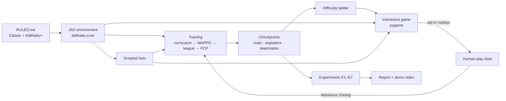

---

## 2. Background: the traditional game

**Kilithattu Kali** (also *Uppukali* in parts of Malabar) is a line-tag team game played during Onam.
The [Kerala Tourism description](https://www.keralatourism.org/onam/onam-games/kilithattukali) says:

- The field is a large rectangle, divided into two equal parts lengthwise and five boxes across.
- Two teams of five. One player is the **Kili**, the most skilled player, who "has lots of advantages".
- The Kili stands at the front; the game starts with the **Kili's clap**.
- The opposing team must enter each box and come out without being hit by the Kili or by the players
  standing on the lines. **The Kili can move along any line.**
- Those who come out without being hit are **uppu** (salt); those still in the inner boxes are
  **pacha** (green). **If salt and green are in the same box, it is a foul.**
- The field can be enlarged for more players.

The written description is short, so where it is silent we borrow from the closely related Indian game
**[Atya-patya](https://en.wikipedia.org/wiki/Atya_patya)**: defenders confined to trenches (lines), a
special front defender who may also run the central line, attackers crossing every trench and returning
("Tond") for double score, and a fault for defenders turning more than 90°.

| Element | Kerala Tourism (Kilithattu) | Atya-patya (related) | **Our interpretation** |
|---|---|---|---|
| Field | Rectangle, 2 parts lengthwise, 5 boxes across | Central trench + 9 cross trenches | 2 lanes × 5 rows = 10 boxes; 6 transverse lines + centre line |
| Teams | 2 teams × 5 players | One defender per trench | Defence = Kili + 4 guards; attack = 4 crossers |
| Special defender | Kili: front, moves on any line, claps to start | Front defender may also run the central trench | Kili starts on the front line, moves on the whole line network |
| Other defenders | "Players standing in the lines" | Confined to own trench | One guard per internal line, lateral movement only |
| Attackers | Enter every box and come out unhit | Cross all trenches, then return | Cross all lines → become uppu → return home |
| Uppu / pacha | Salt = came out; green = inside; same box = foul | — | Status flags; same-box foul puts the offender out |
| Scoring | Not specified | 1 point per trench, 18 for a full round trip | 1 point per line each way + 6 bonus = 18 per round trip |
| Time | Not specified | 4 innings × 7 minutes | 4 innings × 120 s (configurable) |

> **Validation task (Phase 0):** watch play footage (e.g. this
> [Malayalam explainer](https://www.youtube.com/watch?v=M3lOgn3hMiY)) and, ideally, talk to people who
> have played it. Every interpretation above is recorded in the decision log (§4.7) and can be changed
> through configuration.

---

## 3. Goals, research questions and deliverables

### 3.1 What we are achieving

| # | Goal |
|---|---|
| G1 | A **faithful, formal, digital Kilithattu** — every rule unambiguous, tested and configurable. |
| G2 | An **improved version (Kilithattu+)** whose additions deepen strategy without changing the identity of the game. |
| G3 | **Strong deep-RL agents** for all three roles, robust against exploitation (self-play league). |
| G4 | A **fun interactive game**: play as a crosser trying to become uppu, as the Kili, or as a guard; with AI teammates and opponents at several difficulty levels; or watch AI vs AI. |
| G5 | **AI teammates that work with humans**, not just with copies of themselves. |
| G6 | **Research insights** on rule design, RL-driven balancing, generalisation and human–AI teaming. |
| G7 | **Cultural showcase** — a well-documented, playable, modern presentation of a Kerala folk game. |

### 3.2 Research questions

| ID | Question |
|---|---|
| RQ1 | Which Kilithattu+ rules increase **strategic depth** (non-transitivity, behavioural diversity) without making the game degenerate? |
| RQ2 | Can RL agents **automatically balance** the game's parameters, and do their choices agree with human play-testing? |
| RQ3 | Does an entity-attention policy **generalise** to unseen field sizes and team sizes? |
| RQ4 | How much does **league training reduce exploitability** compared to naive self-play in this asymmetric team game? |
| RQ5 | Do meaningful **team calls** emerge, and do they improve coordination (especially around the foul rule)? |
| RQ6 | Does **Fictitious Co-Play** produce better AI teammates for humans than pure self-play agents? |

### 3.3 Deliverables

1. A uv-workspace monorepo of five packages (§8): `kilithattu-core` (JAX environment, Classic + Kilithattu+,
   with tests and a reference implementation), `kilithattu-agents`, `kilithattu-train`, `kilithattu-eval` and
   `kilithattu-game`.
2. `RULES.md` — the canonical rule specification and decision log.
3. Trained agents — league main agents, exploiters, human-compatible teammates, and a difficulty-ladder manifest.
4. The game — menus, all modes, HUD, tutorial, replays, spectator tools.
5. Experiment code, results, figures and a written report (paper-style).
6. A dataset of opt-in human replays and a behaviour-cloned human-proxy model.
7. A demo video and a packaged release (`uv run kilithattu play`).

### 3.4 Non-goals

- 3D graphics or realistic body physics (top-down 2D is enough).
- Online multiplayer (stretch goal only).
- Declaring a single "official" historical rule set — we document our interpretation and keep it configurable.

### 3.5 Success criteria

| Area | Criterion |
|---|---|
| Environment | All rule tests and JAX-vs-reference differential tests pass; replays are bit-for-bit deterministic; throughput target met (§9, Phase 1). |
| Agents | League main team beats the scripted team in ≥ 95 % of matches; Elo increases across league generations; exploitability proxy lower than the naive self-play baseline. |
| Game | Every mode playable end to end; p99 simulation tick (including inference) < 10 ms on a laptop CPU; human win rate decreases monotonically with difficulty. |
| Research | RQ1–RQ6 each answered with ≥ 3 seeds and 95 % confidence intervals. |
| Release | Fresh machine to playing in under 5 minutes; report and demo video published. |

**MVP cut line:** Phases 0–4 (Classic rules + P1/P2, MAPPO agents, playable game vs RL) form a complete
project on their own. Phases 5–7 add depth.

---

## 4. Game specification

### 4.1 Field geometry

Units are metres. Defaults: `n_L = 2` lanes of width `w = 3`, `n_B = 5` rows of depth `d = 3`.
Field width `W = n_L·w = 6`, field length `L = n_B·d = 15`.

```
       x=0             x=3             x=6
 y=17  ┄┄┄┄┄┄┄┄┄┄┄┄┄┄┄┄┄┄┄┄┄┄┄┄┄┄┄┄┄┄┄┄┄┄┄   far-zone boundary
                FAR ZONE (safe) → UPPU
 y=15   J═══════════════J═══════════════J    L5  no fixed guard (Kili can reach it)
        ║    box 0,4    ║    box 1,4    ║
 y=12   J───────────────J───────────────J    L4  Guard 4  ◄─►
        ║    box 0,3    ║    box 1,3    ║
 y=9    J───────────────J───────────────J    L3  Guard 3  ◄─►
        ║    box 0,2    ║    box 1,2    ║
 y=6    J───────────────J───────────────J    L2  Guard 2  ◄─►
        ║    box 0,1    ║    box 1,1    ║
 y=3    J───────────────J───────────────J    L1  Guard 1  ◄─►
        ║    box 0,0    ║    box 1,0    ║
 y=0    J═══════════════J═══════════════J    L0  KILI starts at the centre junction
                HOME ZONE (safe), PACHA
 y=-2  ┄┄┄┄┄┄┄┄┄┄┄┄┄┄┄┄┄┄┄┄┄┄┄┄┄┄┄┄┄┄┄┄┄┄┄   home-zone boundary

 J = junction (the Kili may change line here)
 ║ = longitudinal lines at x = 0, 3, 6      ─ / ═ = transverse lines L0 … L5
 Crossers travel HOME (bottom) → FAR (top) → back to HOME.
```

- **Transverse lines** `L_k` at `y = k·d`, `k = 0 … n_B`.
- **Longitudinal lines** at `x = j·w`, `j = 0 … n_L` (two side edges plus the centre line).
- **Boxes** `(j, k)` with `j = min(⌊x / w⌋, n_L − 1)`, `k = ⌊y / d⌋` for `0 ≤ y < L` (a crosser exactly on a
  line belongs to the higher-index box).
- **Kili graph**: nodes = all junctions `(j·w, k·d)` → 3 × 6 = 18 nodes; edges = transverse segments
  (6 lines × 2 = 12) + longitudinal segments (3 lines × 5 = 15) = 27 edges.
- **Safe zones**: home `y ∈ [−2, 0)`, far `y ∈ (L, L + 2]`.

### 4.2 Roles and movement

| Role | Count | Movement | Special |
|---|---|---|---|
| **Crosser** (attack) | 4 | Free 2D movement | Status pacha / uppu / out |
| **Guard** (defence) | `n_B − 1` = 4 | 1D along its own transverse line `L1 … L4` | Tags within reach |
| **Kili** (defence) | 1 | Along any segment of the line graph; changes line only at junctions | Claps to start; faster; roams |

### 4.3 Classic rules

| ID | Rule |
|---|---|
| R1 | **Field**: `n_L × n_B` boxes, lines and zones as in §4.1. |
| R2 | **Safe zones**: crossers in the home or far zone cannot be tagged. |
| R3 | **Setup**: crossers start in the home zone; the Kili at the centre junction of L0; guard *k* on line L*k* at a random `x`. |
| R4 | **Clap**: play starts on the Kili's clap (Classic: automatic at 2 s). Before the clap, crossers are held behind L0 and defenders may reposition. The innings clock starts at the clap. |
| R5 | **Guard movement**: a guard moves only along its own line, `x ∈ [0, W]`. |
| R6 | **Kili movement**: the Kili moves along line segments and may turn only at junctions. |
| R7 | **Crosser movement**: free 2D. Leaving the field through a side boundary (`x < 0` or `x > W`) while between L0 and L5 puts the crosser **out**. |
| R8 | **Tag**: a defender tags a crosser if their distance is ≤ `r_tag` at *any moment* during the tick (swept test) and the crosser is not in a safe zone. A tagged crosser is out for the rest of the innings. |
| R9 | **Status**: a crosser is **pacha** until it crosses L5 into the far zone, when it becomes **uppu**. An uppu that crosses L0 back into the home zone **delivers salt** and becomes pacha again; it may start another trip. |
| R10 | **Foul**: if an uppu and a pacha occupy the same box at the end of a tick, the crosser that *entered* that box this tick is out. If both entered this tick, the uppu is out. |
| R11 | **Scoring**: see §4.4. |
| R12 | **Innings end**: when all crossers are out, or the clock reaches `T`. Remaining time is forfeited. |
| R13 | **Match**: teams alternate attack and defence for 4 innings (2 each). Highest total wins. If tied, one extra pair of 60 s innings; if still tied, the team with more salt deliveries wins; otherwise a draw. |
| R14 | **Resolution order**: within a tick, tags are resolved **before** line crossings (defender advantage). |

### 4.4 Scoring

Each crosser keeps a **trip progress counter** `κ ∈ {0, …, 2(n_B+1)}` (0 … 12 by default):

- Outbound, crossing `L0, L1, …, L5` in the +y direction raises `κ` from 1 to 6.
- Inbound, crossing `L5, L4, …, L0` in the −y direction raises `κ` from 7 to 12.
- **+1 point** only when a crossing is the *next expected line in the expected direction* (so `κ` increases).
  Retreating and re-crossing earns nothing, which prevents point farming.
- On `κ = 12` (**salt delivered**): **+6 bonus**, `κ ← 0`, `trips ← trips + 1`.

A full round trip is therefore worth 6 + 6 + 6 = **18 points** (the same as Atya-patya's *lona*).

### 4.5 Kilithattu+ rule layer

Each improvement is an independent toggle. **Classic** = all off. **Plus** = P1–P4 on (P5–P7 used in
training and in selected modes).

| ID | Name | What changes | Why it improves the game | Key parameters |
|---|---|---|---|---|
| P1 | **Momentum & stamina** | Acceleration-limited movement; sprint or dash drains stamina, which regenerates when walking | Feints and baiting become real; no instant dodges; energy management | `a_max`, walk / sprint speeds, drain, regen |
| P2 | **Facing & turning** | Guards and the Kili face toward home or toward far; they can tag only within ±90° of facing; turning takes `t_turn` and blocks tagging | Returning uppu attack from behind → timing dilemmas; mirrors Atya-patya's turning fault | cone, `t_turn` |
| P3 | **Limited vision** | Vision cone and radius per role; unseen players are masked; last-seen memory | Hidden information; needs memory; decoys become effective | FOV, radius |
| P4 | **Strategic clap** | The Kili chooses when to clap within a window; crossers pre-position in the home zone; crossing L0 early (false start) = out | An opening mind-game every innings | window, false-start rule |
| P5 | **Procedural fields** | `n_L ∈ {2, 3}`, `n_B ∈ {4 … 9}`, crossers ∈ {3 … 6}; guards = `n_B − 1` | Matches "the field grows with more players"; tests generalisation | ranges |
| P6 | **Team calls** | Each team emits one of K = 4 discrete calls every 0.5 s, heard only by teammates | Emergent signalling, like shouted calls on a real field | K, period |
| P7 | **Human-fair reflexes** | Observation delay and sticky actions for agents | Fair and human-like play against people | delay range, stickiness |

### 4.6 Default parameters

All values are initial and get tuned in Phase 2 (by hand) and experiment E2 (RL-driven balancing).

| Parameter | Symbol | Default |
|---|---|---|
| Tick length | `dt` | 0.05 s (20 Hz) |
| Lanes × rows | `n_L × n_B` | 2 × 5 |
| Lane width / row depth | `w / d` | 3.0 m / 3.0 m |
| Safe-zone depth | `z` | 2.0 m |
| Crossers | `n_a` | 4 |
| Tag reach (guard and Kili) | `r_tag` | 0.6 m |
| Classic speeds: crosser / guard / Kili | `v` | 5.0 / 4.2 / 4.8 m/s |
| P1 crosser walk / sprint | | 3.5 / 6.0 m/s |
| P1 guard walk / dash | | 3.5 / 5.0 m/s |
| P1 Kili walk / dash | | 4.0 / 5.5 m/s |
| P1 max acceleration | `a_max` | 20 m/s² |
| P1 stamina drain / regen / minimum to sprint | | 0.35 /s / 0.20 /s / 0.10 |
| P2 tag cone / turn time | | ±90° / 0.30 s |
| P3 FOV & radius: crosser / guard / Kili | | 200° 9 m / 180° 9 m / 360° 12 m |
| P4 clap window | | [1.0, 5.0] s |
| Innings length | `T` | 120 s (2400 ticks) |
| P6 calls / period | `K` | 4 / 10 ticks |
| P7 observation delay / sticky-action probability | | U{0…5} ticks / U[0, 0.1] |

### 4.7 Decision log

| ID | Decision | Reason |
|---|---|---|
| D1 | The Kili starts on L0 and roams the whole line graph; L5 has no fixed guard. | "Kili stands at the front and can move along any line"; 5 defenders = Kili + 4 internal lines. |
| D2 | 4 crossers per attacking team (configurable 3–6). | Team of 5 with one designated Kili; symmetry with 4 guards. |
| D3 | Uppu status is gained on exiting the far side; returning home delivers salt. | The source defines uppu on exit; Atya-patya adds a return journey. |
| D4 | 1 point per line each way + 6 bonus = 18. | Mirrors Atya-patya scoring; rewards partial progress. |
| D5 | Foul → the offending crosser is out. | Simple, strong enough to force coordination. |
| D6 | Home and far zones are safe. | Otherwise the Kili could camp the entrance and tag waiting crossers. |
| D7 | Tags resolve before crossings. | Deterministic tie-break; defender advantage like a referee's benefit of the doubt. |
| D8 | Side exits = out. | Prevents running around the field. |
| D9 | No body collisions; the Kili may share lines with guards. | Keeps physics simple; contact matters only for tags. |
| D10 | Classic guards tag 360°; facing only under P2. | The source says nothing about facing. |
| D11 | Swept (continuous) tag detection. | Prevents tunnelling at high relative speed. |
| D12 | The innings clock starts at the clap; 120 s. | Clear timing for training and play. |

### 4.8 Why this game is interesting for multi-agent RL

- **The mirror problem.** A single crosser facing a single guard is almost a stalemate: the guard mirrors
  the crosser's `x`. The speed ratio `v_guard / v_crosser` and `r_tag` decide whether a lone feint can
  win. The real answer is **teamwork**: two crossers on opposite sides of a box force the guard to choose.
- **The Kili creates overloads.** One fast defender who can appear on any line punishes predictable plans
  and forces crossers to watch for it.
- **The foul rule creates traffic.** Returning uppu need boxes free of outbound pacha, so the attacking team
  must schedule who goes out and who comes back.
- **Asymmetry.** Different action spaces (2D, 1D line, graph), objectives and information per role.
- **Timing and deception** (P1, P2, P4): feints, baiting, clap timing and attacks from behind.

---

## 5. Formal model: the Kilithattu Markov game

### 5.1 Formal definition

An innings is a **two-team, zero-sum, partially observable stochastic game (POSG)**:

$$
\mathcal{G} = \left\langle \mathcal{N}, \mathcal{S}, \{\mathcal{A}_i\}_{i \in \mathcal{N}}, \mathcal{T}, \{\mathcal{O}_i\}, \{Z_i\}, r, \rho_0, \gamma \right\rangle
$$

- **Agents** $\mathcal{N} = \mathcal{N}_A \cup \mathcal{N}_D$: crossers $|\mathcal{N}_A| = n_a = 4$; defenders $|\mathcal{N}_D| = n_B = 5$ (4 guards + Kili).
- **States** $\mathcal{S}$: full physical and rule state (§5.4).
- **Actions** $\mathcal{A}_i$: factorised discrete actions per role (§5.6); joint action $a = (a_i)_{i \in \mathcal{N}}$.
- **Transition** $\mathcal{T}(s' \mid s, a)$: deterministic physics and rules at 20 Hz (§5.7). Randomness comes
  only from the initial-state distribution $\rho_0$ and from P7 noise (sticky actions, sampled delays).
- **Initial state** $\rho_0$: crossers at rest, uniformly random in the home zone (≥ 0.5 m apart); each guard at a
  uniformly random `x` on its line, facing home; the Kili at the centre junction of L0, facing home; all
  stamina = 1; score, clock and every κ = 0; field and team size sampled from the P5 ranges when enabled.
- **Observations** $Z_i(o_i \mid s)$: fog of war (P3) and observation delay (P7).
- **Reward**: team-shared and zero-sum, $r_A(s, a, s') = -r_D(s, a, s')$ (§5.10).
- **Discount** $\gamma = 0.997$ per tick.

Each team acts with decentralised policies conditioned on its own history $h_i$ (the GRU memory):
$\pi_A(a_i \mid h_i)$ for crossers and $\pi_D(a_i \mid h_i, \text{role}_i)$ for guards and the Kili. The objective is

$$
\max_{\pi_A} \min_{\pi_D} \; J(\pi_A, \pi_D), \qquad
J = \mathbb{E}\left[ \sum_{t=0}^{H} \gamma^t \, r_A(s_t, a_t, s_{t+1}) \right].
$$

Useful views of the same model:

- With the opponent fixed, each team faces a **Dec-POMDP** (cooperative, decentralised, partially observable).
- With every other slot fixed (a human playing one crosser), the human faces a **single-agent POMDP**.
- Teammates coordinate *before* play (shared training) and execute independently. The matching solution
  concept for team-vs-team zero-sum games is the **team-maxmin equilibrium with correlation (TMECor)**.
  League self-play approximates it, and we measure the gap with an **exploitability proxy** (§10).

**Markov property.** The state must include everything the rules depend on: velocities and stamina (P1),
turn timers (P2), last-seen memory (P3), the clap timer (P4), and the observation-delay buffer, previous
actions and decision-interval counters (P7). The remaining time is included in observations, so the time limit
is a genuine terminal condition rather than a hidden truncation. When an agent decides only every few ticks
(difficulty levels, §7.5), its own view is a semi-MDP; the environment still steps every tick and repeats the
held action.

### 5.2 Abstract MDP (for intuition)

A coarse, single-crosser abstraction of the game. States are *where the crosser is*; the defenders are
folded into the tag probability of each edge. This is **not** what we simulate — it shows the structure the
agents must learn to exploit.

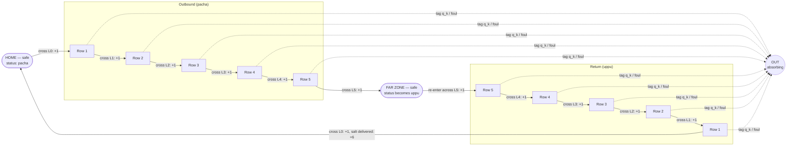

Every in-field state also has **wait / feint / retreat** actions with reward 0. The tag probability
`q_k` of each edge depends on where the guard and the Kili are, and on where teammates are drawing them.
Reducing `q_k` — through feints, splitting guards and timing — is the whole game.

### 5.3 Agent–environment loop

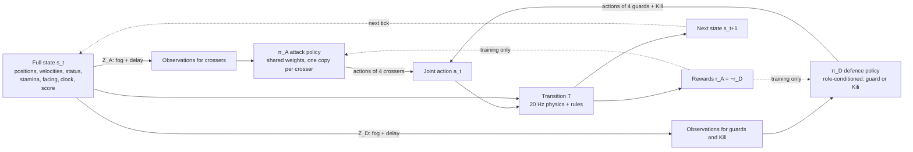

### 5.4 State space

| Component | Per | Contents |
|---|---|---|
| Crosser | each crosser | position `p ∈ ℝ²`, velocity `v ∈ ℝ²`, zone ∈ {home, field, far}, status ∈ {pacha, uppu, out}, trip progress `κ`, trips completed `m`, stamina `e ∈ [0,1]` (P1), heading (P3), current box and previous-tick box (for the foul rule) |
| Guard | each guard | line index, `x ∈ [0, W]`, `ẋ`, facing ∈ {home, far} (P2), turn timer (P2), stamina (P1) |
| Kili | 1 | graph location (edge id, offset) ≡ `p ∈ ℝ²`, velocity, facing and turn timer (P2), stamina (P1), clapped flag |
| Global | 1 | tick since clap `t`, pre-clap timer, score, innings index, field config `(n_L, n_B, n_a)` (P5), last team calls (P6) |
| Memory / noise | per agent | last-seen positions (P3), observation delay ring buffer, previous action, ticks until next decision and held action (P7), RNG key |

All arrays are padded to maximum sizes (6 crossers, 8 guards, 10 transverse lines, 4 longitudinal lines),
with existence masks, so one compiled JAX program covers every field size.

### 5.5 Observation space

Observations are **sets of tokens**, so the network does not depend on the number of players or lines.

**Player token** (one per other player + one for self, 27 features)

| Feature | Dim | Notes |
|---|---|---|
| is_self / is_teammate / is_opponent | 3 | |
| role one-hot (crosser, guard, Kili) | 3 | |
| status one-hot (pacha, uppu, out) + zone one-hot (home, field, far) | 6 | zeros for defenders |
| position relative to ego `(dx/W, dy/L)` | 2 | |
| absolute position `(x/W, y/L)` | 2 | |
| velocity / v_max | 2 | |
| facing `(cos, sin)` | 2 | P2 / P3, otherwise 0 |
| stamina | 1 | own team only; hidden (0) for opponents |
| line index (normalised) / at-junction flag | 2 | defenders |
| trip progress `κ / 12` | 1 | crossers |
| visible flag / time since last seen | 2 | P3 |
| turn timer | 1 | P2 |

**Line token** (one per line, 8 features): transverse or longitudinal (2), endpoints normalised (4),
guard-assigned flag (1), index (1).

**Global token** (≈ 20 features): time remaining, pre-clap flag, clap timer, score difference, innings index,
normalised `(n_L, n_B, n_a)`, rule-toggle bits P1–P7, last team call (P6).

**Action mask**: a per-agent boolean mask for every action head (§5.6).

**Centralised critic input** (training only): the same tokens but with **no fog**, all stamina visible and
true positions.

### 5.6 Action spaces

Actions are **factorised discrete heads** (independent categoricals; log-probabilities are summed). The same
discrete actions are produced by the keyboard or gamepad, so humans and agents have identical controls.
Directions are in the field frame: N = toward the far zone.

| Role | Head | Values | Masking |
|---|---|---|---|
| Crosser | move | 9: stay, N, NE, E, SE, S, SW, W, NW | out → stay only |
| Crosser | sprint | 2 | P1 only; masked if stamina < 0.10 |
| Crosser | call | K + 1 (none + K calls) | P6 only; call ticks only |
| Guard | move | 3: stay, W, E | |
| Guard | dash | 2 | P1 only |
| Guard | turn | 2 | P2 only; masked while turning |
| Kili | move | 5: stay, N, E, S, W | directions without an adjacent segment are masked; all existing segments allowed at a junction |
| Kili | dash | 2 | P1 only |
| Kili | turn | 2 | P2 only |
| Kili | clap | 2 | pre-clap window only (P4) |

**Kili junction snapping:** a perpendicular move is allowed when the Kili is within `v·dt` of a junction; it
snaps to the junction and continues along the new segment within the same tick.

**Movement semantics:** a move direction is a unit vector (diagonals are normalised, so they are not faster),
scaled by the walk or sprint speed. In Classic this sets the velocity directly; under P1 it is the target
velocity for the acceleration limit.

**Masks under delay (P7):** masks are computed from the same delayed observation the agent receives, so they
leak no current information. If a chosen action is invalid by the time it executes, step 2 of §5.7 replaces it
with *stay*.

### 5.7 Transition function: one tick

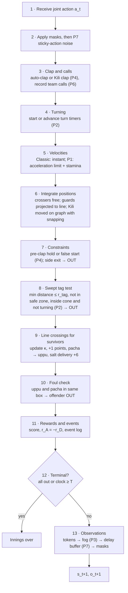

**Swept tag test.** With start offset `δ₀ = p_c − p_d` and per-tick relative motion `Δ = Δp_c − Δp_d`, the
closest approach is at `τ* = clip(−(δ₀·Δ) / (Δ·Δ), 0, 1)` (or `τ* = 0` when `Δ = 0`) with distance `‖δ₀ + τ*Δ‖`. A tag occurs if that
distance is ≤ `r_tag`. A Kili turning at a junction mid-tick is tested on both sub-segments.

### 5.8 Crosser lifecycle (state machine)

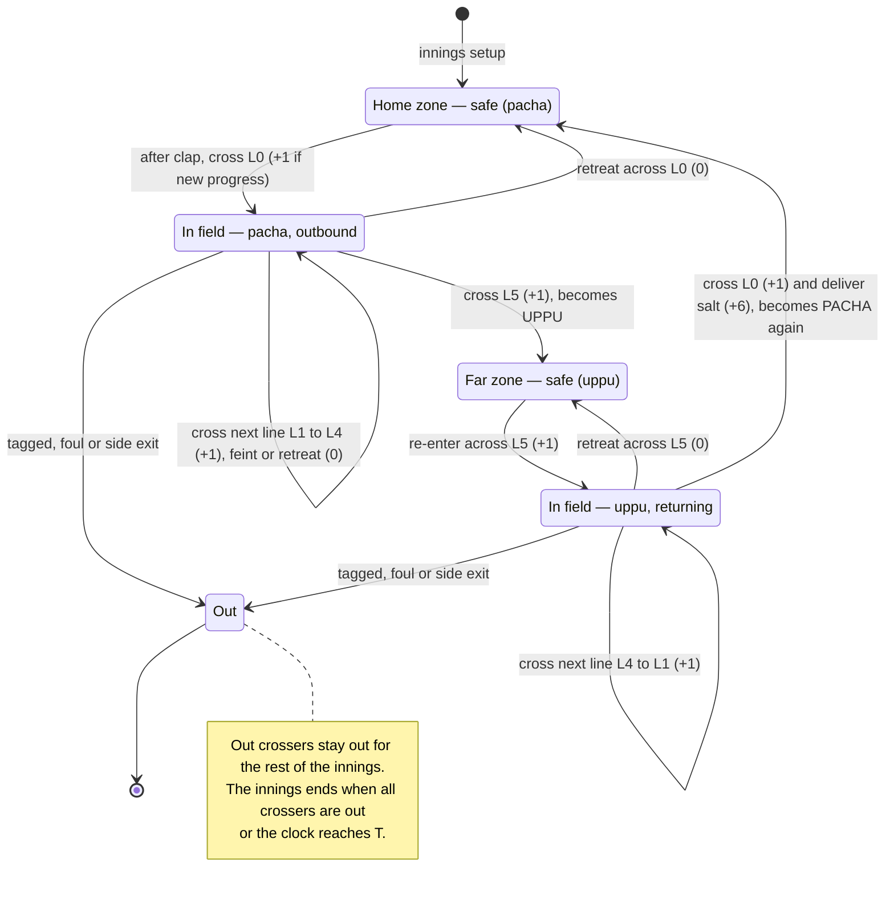

### 5.9 Innings and match flow

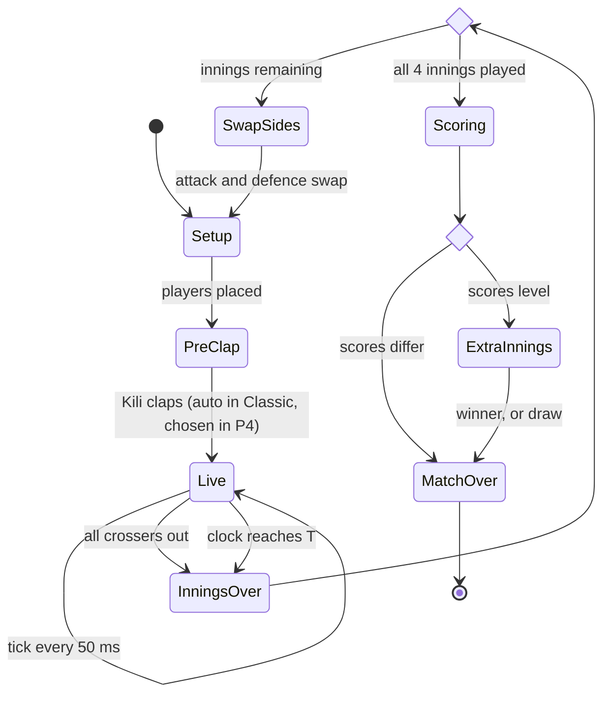

For **training**, one episode = one innings (the roles are asymmetric). Full matches are used for
**evaluation, Elo and the game**.

### 5.10 Reward function

Primary reward (sparse, team-shared, zero-sum, normalised so a round trip = +1):

$$
r_A(t) = \frac{1}{18}\Big( \Delta\text{LinePoints}_t + 6 \cdot \Delta\text{Deliveries}_t \Big)
+ \beta(k)\,\big(\gamma\,\Phi(s_{t+1}) - \Phi(s_t)\big),
\qquad r_D(t) = -r_A(t)
$$

| Event | Attack reward | Defence reward |
|---|---|---|
| Crosser crosses a new line (κ increases) | +1/18 | −1/18 |
| Salt delivered (round trip complete) | +6/18 | −6/18 |
| Crosser tagged, fouled or side exit | 0 (loses all future points) + shaping drop | 0 + shaping gain |
| Time passing | 0 | 0 |

**Potential-based shaping** (annealed to 0 anyway):

- $\Phi(s) = \frac{1}{n_a} \sum_i \phi_i$, with $\phi_i = \text{progress}_i / (2L)$ if crosser *i* is in play
  and $\phi_i = 0$ if it is out (partial-trip progress is lost when tagged).
- `progress_i` is the continuous distance along the current trip: outbound `clip(y, 0, L)`, then
  `L + (L − clip(y, 0, L))` once uppu. It resets to 0 at salt delivery; that shaping drop (at most `β / n_a`)
  is much smaller than the 7/18 earned at the same moment.
- **$\Phi = 0$ in every terminal state.** The discounted shaping sum over an innings then telescopes to
  $-\Phi(s_0)$, a constant, so shaping changes neither the optimal policies (Ng et al., 1999) nor the Nash
  equilibria of the game (Devlin & Kudenko, 2011). Without this, the time-limit terminal would change what is
  optimal.
- **$\Phi$ must stay bounded.** A potential that only grows (e.g. one that adds trips completed) creates a
  per-tick drift of $-(1-\gamma)\,\Phi$, which penalises scoring early.
- $\beta(k)$ goes linearly from 0.5 to 0 over the first 20 % of each curriculum stage (`k` = update index).

**Optional individual credit:** $r_i = (1-\lambda)\,r_A + \lambda\,r_i^{\text{own}}$ with λ = 0.1, annealed
to 0. While λ > 0 the per-agent rewards are not exactly zero-sum, so λ must reach 0 before league training
(§6.5). The centralised critic does most of the credit assignment.

**No explicit tag penalty is needed**: a tagged crosser loses all future scoring, and keeping the reward
purely zero-sum keeps the game-theoretic objective clean.

### 5.11 Episode, discount and horizon

- Horizon: up to 100 pre-clap ticks + 2400 live ticks.
- `γ = 0.997` → effective horizon `1 / (1 − γ) ≈ 333` ticks ≈ 17 s, enough to credit a full round trip
  (≈ 30 m plus feints ≈ 8–12 s). GAE `λ = 0.95`.
- Innings end is a **true terminal** (time is part of the rules and is observed), not a truncation.
- **Innings points are a proxy for winning matches.** Maximising expected points per innings is not the same as
  maximising the chance of winning: a team that needs only 5 points in the last innings should play safe. Base
  training uses the points objective. An optional **match-aware** fine-tuning stage chains the 4 innings into
  one episode, conditions on score difference and innings index (already in the global token), and rewards only
  the match result (+1 / 0 / −1). It is used for the top difficulty levels (Phase 5, step 6).

---

## 6. Learning approach

### 6.1 Why MAPPO with centralised training and decentralised execution

- **MAPPO** (PPO with a centralised critic) is strong and stable in cooperative multi-agent settings, and
  on-policy updates pair well with fully vectorised JAX simulation.
- **Centralised critic** sees the full state → lower-variance advantages under fog of war.
- **Decentralised actors** use only their own observations → the same policy runs in the game, with fog
  and with humans in other slots.
- **Parameter sharing within a role** → sample efficiency and variable team sizes.
- **Factorised discrete actions** → exact parity with human controls.

| Alternative | Why not primary |
|---|---|
| IPPO (independent critics) | Kept as an **ablation baseline** |
| QMIX / VDN | Value factorisation targets purely cooperative games; awkward for team-vs-team zero-sum |
| MADDPG | Continuous actions, less stable, no human-control parity |

### 6.2 Network architecture

Two separate parameter sets: an **attack network** (crosser heads) and a **defence network** (guard and
Kili heads, with a role embedding). Each has its own centralised critic.

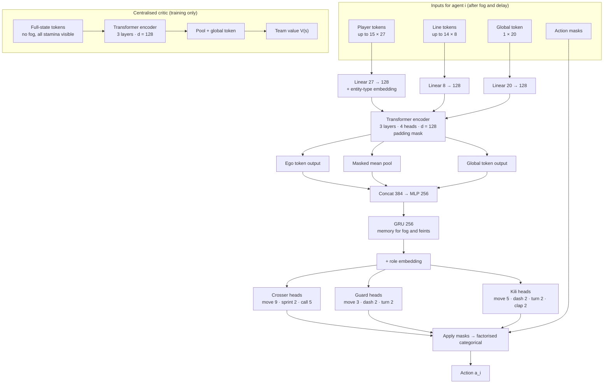

Roughly 0.6 M parameters per actor and per critic. The attention weights double as an **explainability
overlay** in the game (who is each agent watching?).

### 6.3 Training loop and hyperparameters

The whole update — rollout, GAE and PPO epochs — is one JIT-compiled function (PureJaxRL / JaxMARL style):

```python
def update_step(runner_state, _):
    # 1. Rollout: ROLLOUT_LEN ticks × NUM_ENVS envs, both teams act
    runner_state, traj = jax.lax.scan(env_step, runner_state, None, length=ROLLOUT_LEN)
    # 2. Centralised values and GAE per team (zero-sum rewards)
    adv_A, ret_A = gae(traj.reward_A, traj.value_A, traj.done, GAMMA, LAMBDA)
    adv_D, ret_D = gae(-traj.reward_A, traj.value_D, traj.done, GAMMA, LAMBDA)
    # 3. PPO epochs over minibatches, only for the sides that are learning
    runner_state = ppo_update(runner_state, traj, (adv_A, ret_A), (adv_D, ret_D))
    return runner_state, metrics(traj)


train = jax.jit(lambda s: jax.lax.scan(update_step, s, None, length=NUM_UPDATES))
```

| Hyperparameter | Initial value |
|---|---|
| Parallel envs | 2048 (GPU) / 64 (CPU development) |
| Rollout length | 128 ticks (6.4 s) |
| Agent-steps per update | 2048 × 128 × 9 ≈ 2.2 M |
| PPO epochs / minibatches | 4 / 8 |
| Clip ε / value clip | 0.2 / 0.2 |
| Optimiser | Adam, lr 3e-4; linear decay in curriculum, constant in league |
| γ / GAE λ | 0.997 / 0.95 |
| Entropy coefficient | 0.01 → 0.002 |
| Value loss coefficient | 0.5, with running value normalisation |
| Max gradient norm | 0.5 |
| GRU | 256; state reset at episode start; initial state stored per rollout |
| Out agents | excluded from the actor loss (death masking); the team critic still values the state |

**Compute budget (estimates, revisit after Phase 1 and Phase 3):** Classic curriculum ≈ 0.3–0.6 B env
ticks; Plus ≈ +0.3 B; league ≈ 2–5 B. A first target of ~10⁵ env ticks/s end-to-end on one modern GPU
would make 1 B ticks ≈ 3 hours.

### 6.4 Curriculum

Weights carry over between stages without changes (the token network handles any entity count). 10 % of
episodes replay earlier stage configurations to prevent forgetting.

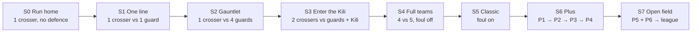

| Stage | Field | Agents | Rules | Learners | Promote when |
|---|---|---|---|---|---|
| S0 | 1 × 2 | 1 crosser | Classic, no defence | attack | ≥ 95 % of episodes deliver salt |
| S1 | 1 × 2 | 1 crosser vs 1 guard | Classic | both | tag rate and delivery rate both in [0.3, 0.7], or plateau |
| S2 | 1 × 5 | 1 crosser vs 4 guards | Classic | both | plateau |
| S3 | 2 × 5 | 2 crossers vs 4 guards + Kili | foul off | both | plateau |
| S4 | 2 × 5 | 4 vs 5 | foul off | both | plateau |
| S5 | 2 × 5 | 4 vs 5 | **Classic complete** | both | plateau → *Classic agents milestone* |
| S6 | 2 × 5 | 4 vs 5 | add P1, P2, P3, P4 one at a time | both | plateau after each |
| S7 | procedural (P5) | 3–6 vs `n_B` | Plus + P6 | league | hand-over to league |

**Plateau** = normalised points per innings (EMA) has improved by < 2 % over the last 50 updates.

### 6.5 Self-play league

Naive self-play in asymmetric games tends to cycle (strategy A beats B, B beats C, C beats A) and forget
old counter-strategies. A small AlphaStar-style league fixes this.

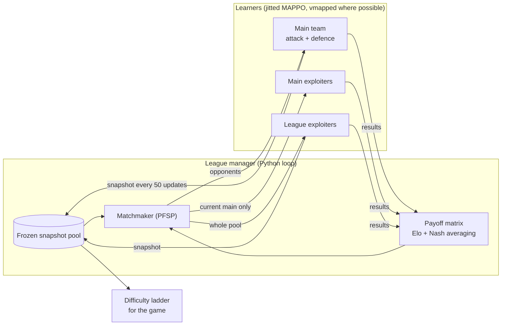

| Learner | Per side | Trains against | Reset | Purpose |
|---|---|---|---|---|
| Main | 1 | 35 % current main of the other side, 50 % PFSP over all snapshots, 15 % current main exploiters | never | strongest, robust agent |
| Main exploiter | 1 | current main of the other side only | to latest main when win rate > 70 % or after 200 M ticks | finds main's weaknesses quickly |
| League exploiter | 1–2 | PFSP over all snapshots | with probability 0.25 when snapshotted | finds global blind spots |

- **Per-innings "win"** (needed for PFSP and side ratings): the attack wins an innings if it scores more
  than `μ_ref`, the running median score of main-vs-main innings; otherwise the defence wins.
- **PFSP**: choose opponent `j` with probability ∝ `(1 − p̂_j)²`, where `p̂_j` is the learner's estimated win
  rate against `j`.
- **Team matches** (attack + defence pairs playing full matches) give the headline **Elo**; **Nash
  averaging** on the payoff matrix avoids Elo's transitivity assumption.
- Evaluation games are cheap: 256 innings per pair, vmapped in one call.

### 6.6 Human-compatible agents (Fictitious Co-Play)

The strongest competitive crosser is not necessarily a good teammate for a human. Agents trained only with
copies of themselves adopt conventions humans don't know, and the foul rule makes this worse. We train a
separate **teammate policy**.

1. **Partner pool:** main snapshots at 5 training stages; 3 independent self-play seeds; scripted crossers
   with randomised aggression, caution and reaction delay; ε-noisy versions; later a **behaviour-cloned human
   model** from opt-in replays (Phase 6).
2. **Each episode**, 1–2 of the 4 crosser slots are controlled by a partner sampled from the pool; the
   learner controls the rest. The partner's identity is hidden.
3. **Random mid-episode possession swaps** teach the policy to take over smoothly when a human switches
   player.
4. **Opponents**: frozen main defence at mixed difficulty levels.
5. **P7 on**: observation delay, decision interval and sticky actions sampled per episode.
6. The same scheme produces a **teammate defence policy** for "Play as Kili" (AI guards working with a
   human Kili).
7. **Evaluation**: cross-play score with *held-out* partners (unseen scripted configs, BC model trained on
   held-out humans) and blind human A/B ratings.

### 6.7 Scripted bots

Scripted bots serve as baselines, curriculum opponents, partner-pool members, the tutorial, and the first
playable opponents before any RL exists.

| Bot | Behaviour | Randomised parameters |
|---|---|---|
| Crosser | For the next line, estimate the guard's intercept time for every `x`; move toward the largest gap; cross when the predicted clearance > `r_tag` + margin; avoid boxes that would cause a foul; head home once uppu | aggression, safety margin, reaction delay |
| Guard | Track the `x` of the most threatening crosser (nearest to its line, weighted by speed toward it); under P2, turn toward returning uppu when they are the bigger threat | reaction delay, anticipation |
| Kili | Move to the graph position that minimises intercept time to the most advanced crosser; patrol the centre line when idle | patrol bias, reaction delay |

### 6.8 Failure modes and reward hacking

| Failure mode | Symptom | Mitigation |
|---|---|---|
| Defence-dominant equilibrium | Crossers never leave home; 0-point innings | Balance parameters (Phase 2, E2); early shaping; curriculum |
| Attack-dominant equilibrium | Nearly every trip succeeds | Adjust speed ratios, `r_tag`, row depth |
| Line farming | Oscillating across a line | Trip-progress rule (§4.4); unit test |
| Tag tunnelling | Missed tags at high relative speed | Swept tag test; unit test at max speeds |
| Kili junction teleport | Snapping exploited to jump | Snap only within `v·dt`; unit test |
| Side-boundary abuse | Running outside the field | Side exit = out |
| Foul abuse | Deliberate fouls | Foul = out, so there is no benefit; monitor foul rate |
| Strategy cycling / forgetting | Oscillating Elo | League + PFSP + snapshots |
| Entropy collapse | Deterministic, brittle early policies | Entropy schedule; monitoring |
| Superhuman reflexes | No fun for humans | P7 + difficulty ladder |
| Non-stationary naive self-play | Unstable curves | Lower lr, alternate freezing, then league |

---

## 7. Interactive game design

### 7.1 Slot and controller architecture

Every player position is a **slot**. A slot is filled by a **controller**. Game modes are just presets of
slot assignments, so every combination (human crosser with AI teammates, AI crossers vs human Kili, all AI,
all human) is supported by the same code.

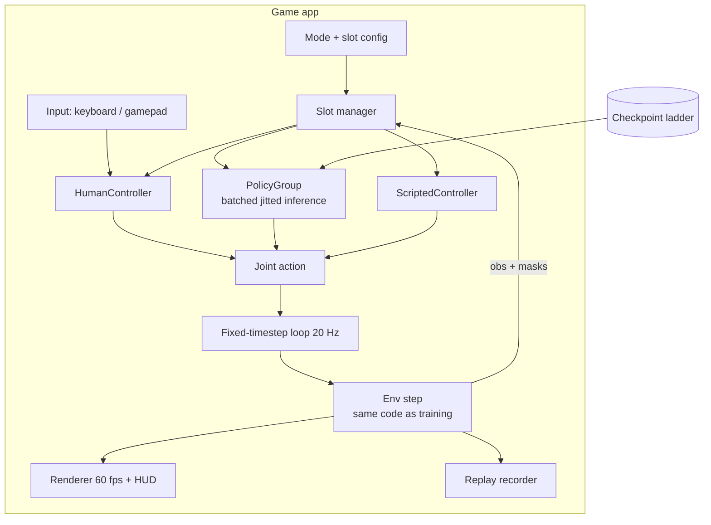

```python
class Controller(Protocol):
    def reset(self, slot: SlotInfo, seed: int) -> None: ...
    def act(self, obs: SlotObs, mask: ActionMask) -> Action: ...
```

`PolicyGroup` batches all slots that use the same checkpoint into **one** jitted forward pass per tick.

Example slot configuration:

```yaml
mode: play_crosser
rules: plus            # classic | plus | custom
field: { lanes: 2, boxes: 5 }
slots:
  attack:  [human, policy:teammate@medium, policy:teammate@medium, policy:teammate@medium]
  defence: { kili: policy:main@hard, guards: policy:main@hard }
```

### 7.2 Game modes

| Mode | Attack (crossers) | Defence (guards + Kili) | Notes |
|---|---|---|---|
| **Tutorial** | Human | Scripted (gentle) | Teaches lines, tags, uppu / pacha, fouls |
| **Play as crosser** (become uppu) | Human + 3 RL teammates | RL (difficulty) | Tab switches which crosser you control |
| **Play as Kili** | RL (difficulty) | Human Kili + RL guards | Human claps (P4) |
| **Play as guard** | RL | Human guard + RL team | Tab cycles guards / Kili |
| **Watch AI vs AI** | RL | RL | Speed control, overlays, win-probability bar |
| **Local versus** | Human (+ RL teammates) | Human Kili (+ RL guards) | Keyboard + gamepad, or two gamepads |
| **Custom lab** | Any | Any | Any rule toggles, field size, checkpoints — for experiments |
| **Replay theatre** | — | — | Scrub, slow motion, event timeline |

**Possession switching:** when you switch crossers, the slot you leave returns to the teammate policy. The
policy runs in **shadow mode** on your slot every tick (its action is discarded), so its GRU memory is
up to date and the handoff is seamless.

### 7.3 Controls

| Action | Keyboard (crosser) | Keyboard (Kili / guard) | Gamepad |
|---|---|---|---|
| Move | W A S D (combinations = diagonals) | W A S D (guards: A / D only) | Left stick → 8 sectors, dead-zone 0.3 |
| Sprint / dash (P1) | Left Shift | Left Shift | RT |
| Turn (P2) | — | Q | LB |
| Clap (P4) | — | Space | A |
| Team calls 1–4 (P6) | 1 2 3 4 | 1 2 3 4 | D-pad |
| Switch player | Tab | Tab | RB |
| Pause | Esc | Esc | Start |
| Slow motion (practice modes) | ` | ` | Select |

- **Tap latching:** edge-triggered inputs (clap, turn, call, switch) are latched between ticks so a quick
  tap is never lost.
- **Kili turn buffering:** holding a direction that isn't valid yet (e.g. N while running along L0)
  keeps the Kili moving and applies the turn at the next junction.
- **Team calls with humans:** learned call meanings are arbitrary. For human play, P6 is either disabled or
  shown as icons whose meaning comes from the analysis in E5 (stretch: grounded calls via an auxiliary loss).

### 7.4 Real-time loop and timing

- **Simulation** at a fixed 20 Hz (the training tick) using an accumulator; **rendering** at 60 fps,
  interpolating between the previous and current states.
- **Inference budget:** one batched jitted call per policy group per tick; target p99 < 10 ms on a laptop
  CPU. JIT warm-up runs behind the loading screen.
- **Fairness:** human effective latency ≈ frame delay + reaction time; agents get a matched observation delay
  per difficulty level.

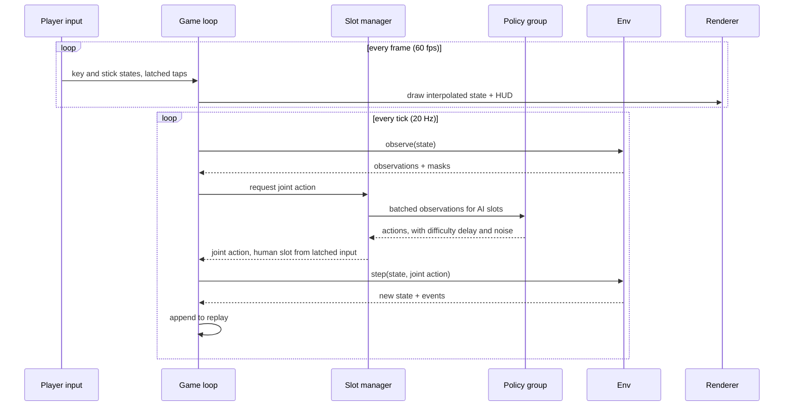

### 7.5 Difficulty ladder

Built from league snapshots (§6.5), then calibrated with human play-tests.

| Level | Policy | Observation delay | Decision interval | Sticky actions | Target human win rate |
|---|---|---|---|---|---|
| Beginner | scripted bots, low aggression | 300 ms | 150 ms | 0.15 | ~80 % |
| Easy | snapshot, bottom-quartile Elo | 250 ms | 100 ms | 0.10 | ~60 % |
| Medium | snapshot, median Elo | 200 ms | 100 ms | 0.05 | ~40 % |
| Hard | league main | 150 ms | 50 ms | 0 | ~20 % |
| Kalari Master | league main, minimal handicap | 50 ms | 50 ms | 0 | < 5 % |

### 7.6 HUD, UX and spectator tools

**In play**

- Top bar: score, innings number, clock, clap indicator.
- Crossers: **pacha** shown with a green leaf icon, **uppu** with a white salt-crystal icon, out with a grey
  cross. Icons *and* colours, so the game is colour-blind friendly.
- Stamina arc under the controlled player (P1); facing wedge on defenders (P2); fog of war (P3).
- **Foul warning**: a box tints red if entering it would cause a foul.
- Event feedback: `+1` pop-ups on line crossings, "UPPU!" on reaching the far zone, "SALT +6" on delivery,
  flash + "OUT" on tags, clap sound at the start.

**Watch mode and replays**

- **Win-probability bar** from the centralised critic's value estimate.
- **Attention lines**: from each agent to the 1–2 players it attends to most.
- Occupancy heatmaps, action-probability arrows, speed control 0.25× – 8×, event timeline scrubbing.

**Theme**: an Onam look — sand-textured ground, pookalam-inspired field border, clap and crowd audio.

### 7.7 Replays and human data

Because the environment is deterministic, a replay is the configuration + seed + action log:

```
replays/2026-10-02T18-22-10_play_crosser.kreplay/
  header.json    # format version, env version hash, rules + params, seed,
                 # slot controllers + checkpoint ids, human slot ids, possession timeline
  actions.npz    # int8 array [ticks, agents, heads]
  events.jsonl   # tags, fouls, crossings, deliveries (fast seeking and analytics)
```

With the player's opt-in, human replays go to a dataset used for the behaviour-cloned human proxy (§6.6)
and the human-play analysis (E6).

### 7.8 Screen flow

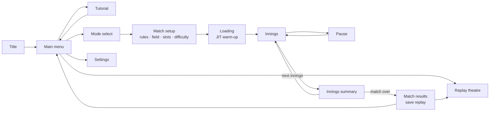

---

## 8. System architecture and repository layout

This section describes how the software is organised: the main components and how they depend on each
other, where code, models and data live, how artifacts are versioned, and how the project is built, tested
and released.

### 8.1 Architecture overview

**Principles**

1. **One rules engine.** Training, evaluation, the game and replays all call the same `kilithattu_core` step
   function. Rule logic is never duplicated; the plain-Python reference implementation exists only for tests.
2. **Dependencies point one way.** The core knows nothing about learning, and the game never imports training
   code. This is enforced in CI (§8.4).
3. **Pure functions, explicit state.** The environment is a pure JAX function of `(key, state, actions, params)`,
   which makes it vectorisable, deterministic and replayable.
4. **Every artifact is traceable.** Each checkpoint and replay records the git commit, resolved config,
   environment version and rules hash.
5. **Configuration over code.** Rule variants, curricula, league settings and game modes are YAML configs, not
   code branches.

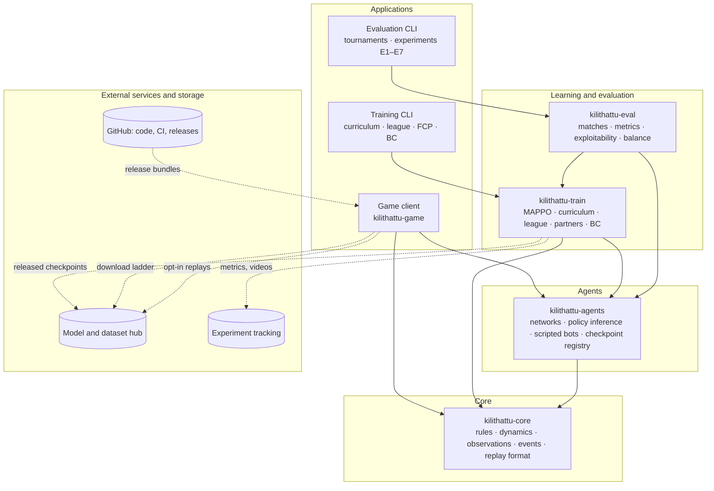

| Component | Responsibility | Used by |
|---|---|---|
| `kilithattu-core` | Rules, physics, observations, action masks, event log, replay read/write/verify | everything |
| `kilithattu-agents` | Network definitions, batched policy inference, human-fair wrappers, scripted bots, checkpoint loading, ladder registry | train, eval, game |
| `kilithattu-train` | Rollouts, MAPPO, curriculum, league, FCP partner pool, behaviour cloning, logging | eval, training CLI |
| `kilithattu-eval` | Innings and match runner, metrics, tournaments and ratings, exploitability, behaviour detectors, balance search, plots | evaluation CLI, experiments |
| `kilithattu-game` | Slots and controllers, input, real-time loop, rendering, menus, tutorial, replay theatre, audio | players |

### 8.2 Repository strategy

**Decision:** one **monorepo** for all code and documentation, organised as a **uv workspace of five Python
packages**, with large binary artifacts (checkpoints, replays) stored outside git.

| Option | Pros | Cons | Verdict |
|---|---|---|---|
| Single package in one repo | Simplest setup | Installing the game pulls in training dependencies (Optax, W&B, Optuna); no enforced boundaries | Too loose |
| **Monorepo, uv workspace of packages** | One pull request can change rules, agents and game together; one lockfile; enforced boundaries; lean game install | Slightly more setup | **Chosen** |
| Separate repos (env, training, game) | Independent release cycles | Every rule change needs coordinated releases; the game and training can drift onto different rule versions | Too heavy for a small team |

**Where everything lives**

| Store | Contents | Name / location | Access | Versioning |
|---|---|---|---|---|
| Code repository | Source, configs, tests, docs, small results, ladder manifest | GitHub `Kilithattukali` | Team; public at release | git, tags `vX.Y.Z` |
| Model repository | Released checkpoints (difficulty ladder, main agents, teammates) | Hugging Face Hub model repo `kilithattu-agents` | Public at release | Hub revisions, pinned by commit hash in `configs/game/ladder.yaml` |
| Dataset repository | Opt-in human replays, behaviour-cloning datasets | Hugging Face Hub dataset repo `kilithattu-replays` | **Private** until consent and anonymisation are checked | Hub revisions |
| Experiment tracking | Curves, videos, payoff matrices, resolved configs | Weights & Biases project `kilithattu-rl` | Team | Run ids |
| Local run storage | All intermediate checkpoints, league state, logs | `runs/` on the training machine (git-ignored) | Local | Run-id folders |
| Report | Paper-style report and figures | `docs/report/` in the code repository | Team | git |

Released policies are small (≈ 0.6 M parameters, a few MB each), so the whole ladder also fits in a GitHub
release asset. If the Hugging Face Hub is not an option, use GitHub Releases for the ladder and DVC with any
remote storage for datasets.

### 8.3 Workspace layout

```
Kilithattukali/
├── README.md                         # quick start: install, play, train
├── PLAN.md                           # this document
├── PROPOSAL.md                       # research proposal
├── RULES.md                          # canonical rules, parameters, decision log
├── CONTRIBUTING.md                   # workflow, conventions, how to add a rule toggle
├── LICENSE
├── pyproject.toml                    # uv workspace root: members + shared ruff / pyright / pytest config
├── uv.lock                           # one lockfile for the whole workspace
├── .python-version                   # 3.11
├── .pre-commit-config.yaml
├── .importlinter                     # package dependency contracts (§8.4)
├── .gitignore
│
├── .github/
│   ├── workflows/
│   │   ├── ci.yml                    # lint, types, import contracts, unit + property tests, game smoke
│   │   ├── nightly.yml               # differential tests, golden replays, training smoke, benchmarks
│   │   └── release.yml               # game bundles, ladder manifest, GitHub release
│   ├── ISSUE_TEMPLATE/
│   └── pull_request_template.md
│
├── packages/
│   ├── kilithattu-core/              # rules engine; depends only on JAX
│   │   ├── pyproject.toml
│   │   ├── src/kilithattu_core/
│   │   │   ├── __init__.py           # ENV_VERSION, make_env()
│   │   │   ├── config.py             # EnvParams, rule toggles, YAML loading, rules hash
│   │   │   ├── geometry.py           # field, lines, boxes, Kili graph
│   │   │   ├── state.py              # EnvState pytree
│   │   │   ├── dynamics.py           # velocities, stamina, line projection, graph motion
│   │   │   ├── rules.py              # clap, tags, crossings, scoring, fouls, termination
│   │   │   ├── observe.py            # tokens, fog, delay buffer, action masks
│   │   │   ├── spaces.py             # action heads, token shapes, padding limits
│   │   │   ├── events.py             # typed event log: tags, fouls, crossings, deliveries
│   │   │   ├── env.py                # reset / step / critic_state (JaxMARL-style API)
│   │   │   ├── replay.py             # replay format: write, read, re-simulate, verify
│   │   │   └── reference/            # slow pure-Python rules, used only by tests
│   │   └── tests/                    # unit, property, determinism, differential, golden replays
│   │
│   ├── kilithattu-agents/            # everything needed to RUN agents; no training dependencies
│   │   ├── pyproject.toml
│   │   ├── src/kilithattu_agents/
│   │   │   ├── networks.py           # entity-attention actor and critic (Flax)
│   │   │   ├── policy.py             # Policy protocol, batched act(), recurrent carry
│   │   │   ├── human_fair.py         # observation delay, decision interval, sticky actions
│   │   │   ├── checkpoint.py         # load / save with metadata and compatibility checks
│   │   │   ├── registry.py           # resolve "main@hard" via ladder manifest; hub download + cache
│   │   │   └── scripted/             # crosser.py, guard.py, kili.py (same Policy protocol)
│   │   └── tests/
│   │
│   ├── kilithattu-train/             # learning
│   │   ├── pyproject.toml
│   │   ├── src/kilithattu_train/
│   │   │   ├── rollout.py            # vmapped env + policy scan
│   │   │   ├── mappo.py              # GAE, PPO loss, update step, value normalisation, death masking
│   │   │   ├── curriculum.py         # stages, promotion, stage replay
│   │   │   ├── league/               # pool.py, matchmaker.py (PFSP), learners.py, payoff.py, state.py
│   │   │   ├── partners.py           # FCP partner pool
│   │   │   ├── bc.py                 # behaviour cloning from replays
│   │   │   ├── logging.py            # W&B / TensorBoard adapters
│   │   │   └── cli.py                # kilithattu-train stage | league | fcp | bc
│   │   └── tests/                    # smoke tests: a few updates on a tiny field
│   │
│   ├── kilithattu-eval/              # measurement and experiments
│   │   ├── pyproject.toml
│   │   ├── src/kilithattu_eval/
│   │   │   ├── matches.py            # vmapped innings and full matches between any policies
│   │   │   ├── metrics.py            # points per innings, competitiveness, depth metrics
│   │   │   ├── ratings.py            # Elo, Nash averaging
│   │   │   ├── tournament.py         # payoff matrices
│   │   │   ├── exploitability.py     # best-response training (uses kilithattu_train)
│   │   │   ├── behaviours.py         # split-guard, decoy, Kili-bait detectors
│   │   │   ├── balance.py            # Optuna outer loop (E2)
│   │   │   ├── generalisation.py     # held-out field and team sizes (E3)
│   │   │   ├── plots.py
│   │   │   └── cli.py                # kilithattu-eval tournament | exploit | balance | report
│   │   └── tests/
│   │
│   └── kilithattu-game/              # the interactive game
│       ├── pyproject.toml
│       ├── src/kilithattu_game/
│       │   ├── app.py                # entry point: kilithattu play
│       │   ├── loop.py               # fixed-timestep simulation + render interpolation
│       │   ├── slots.py              # slot manager, PolicyGroup batching, possession switching
│       │   ├── controllers/          # human.py, policy.py, scripted.py
│       │   ├── input/                # keyboard.py, gamepad.py, quantise.py, latching.py
│       │   ├── render/               # field.py, players.py, hud.py, overlays.py
│       │   ├── ui/                   # menus.py, match_setup.py, tutorial.py, results.py
│       │   ├── replay_theatre.py
│       │   ├── audio.py
│       │   └── assets/               # sprites, fonts, sounds (small, kept in git)
│       └── tests/                    # headless smoke tests (SDL dummy video driver)
│
├── configs/
│   ├── rules/                        # classic.yaml, plus.yaml, variants/
│   ├── train/                        # curriculum.yaml, league.yaml, fcp.yaml, bc.yaml
│   ├── eval/                         # tournament.yaml, e1_rules.yaml … e7_tactics.yaml
│   └── game/                         # modes.yaml, difficulty.yaml, ladder.yaml (pinned hub revisions)
│
├── experiments/                      # one folder per experiment
│   └── e1_rule_ablation/             # README.md (question, setup), runs.md, results.md, figures/
│
├── tools/                            # bench_env.py, export_ladder.py, check_docs.py, release helpers
├── notebooks/                        # exploratory analysis only; never imported by packages
│
├── docs/
│   ├── adr/                          # architecture decision records: 0001-monorepo.md, 0002-jax.md, …
│   ├── benchmarks.md
│   ├── balance.md
│   ├── figures/
│   └── report/
│
├── runs/                             # git-ignored: local checkpoints, league state, logs, videos
└── data/                             # git-ignored: downloaded replays and datasets
```

### 8.4 Package dependencies and install profiles

Arrows mean "depends on".

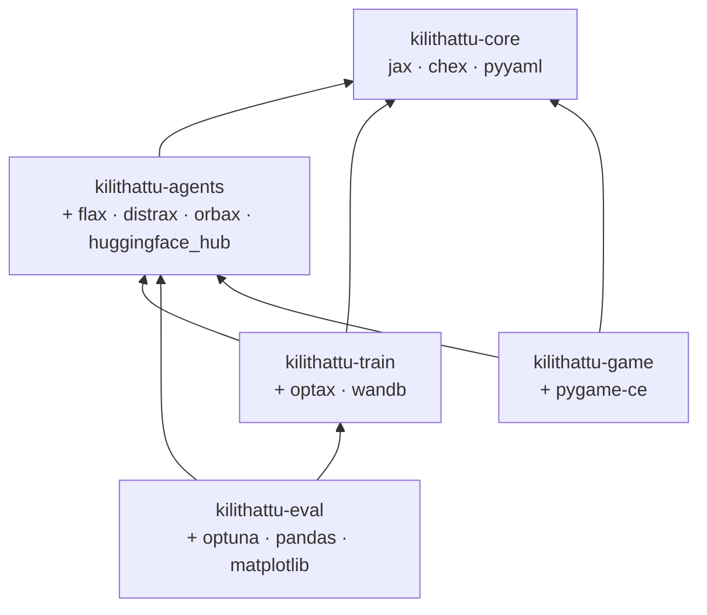

**Dependency contracts** (checked by `import-linter` in CI):

| Contract | Reason |
|---|---|
| `kilithattu_core` imports no other workspace package | Rules stay reusable and fast to test |
| `kilithattu_agents` does not import `train`, `eval` or `game` | Running agents needs no training stack |
| `kilithattu_game` does not import `train` or `eval` | Players never install training dependencies |
| No package imports from `experiments/`, `tools/` or `notebooks/` | Research scripts cannot become hidden dependencies |

**Install profiles**

| Who | Command | Gets |
|---|---|---|
| Player | packaged release, or `uv tool install kilithattu-game` | core, agents, game (CPU JAX) |
| Game developer | `uv sync --package kilithattu-game` | core, agents, game + dev tools |
| Researcher (CPU) | `uv sync --all-packages` | everything |
| Researcher (GPU) | `uv sync --all-packages --extra cuda` | everything + `jax[cuda12]` |

### 8.5 Component interfaces

These are the contracts between packages. Everything else is internal and free to change.

```python
# ── kilithattu_core ────────────────────────────────────────────────────────────
ENV_VERSION: str  # semantic version of step() behaviour


def make_env(params: EnvParams) -> KilithattuEnv: ...
def rules_hash(params: EnvParams) -> str: ...


class KilithattuEnv:
    def reset(self, key: PRNGKey, params: EnvParams) -> tuple[Obs, EnvState]: ...
    def step(
        self, key: PRNGKey, state: EnvState, actions: Actions, params: EnvParams
    ) -> tuple[Obs, EnvState, Rewards, Dones, Events]: ...
    def critic_state(self, state: EnvState, params: EnvParams) -> CriticObs: ...


def write_replay(path: Path, header: ReplayHeader, actions: Array, events: Events) -> None: ...
def verify_replay(path: Path) -> bool: ...  # re-simulates and compares the event log


# ── kilithattu_agents ──────────────────────────────────────────────────────────
class Policy(Protocol):  # RL networks and scripted bots both implement this
    def init_carry(self, num_agents: int) -> Carry: ...
    def act(
        self, key: PRNGKey, carry: Carry, obs: Obs, mask: ActionMask
    ) -> tuple[Actions, Carry, PolicyInfo]: ...  # PolicyInfo: value, attention (for overlays)


def load_policy(ref: str) -> Policy: ...


# refs: "main@hard", "teammate@medium", "run:<run_id>/step:<n>", "scripted:guard?aggression=0.7"


# ── kilithattu_eval ────────────────────────────────────────────────────────────
def play_innings(
    attack: Policy, defence: Policy, params: EnvParams, n: int, key: PRNGKey
) -> InningsResults: ...
def play_matches(
    team_a: Team, team_b: Team, params: EnvParams, n: int, key: PRNGKey
) -> MatchResults: ...


# ── kilithattu_game ────────────────────────────────────────────────────────────
class Controller(Protocol):
    def reset(self, slot: SlotInfo, seed: int) -> None: ...
    def act(self, obs: SlotObs, mask: ActionMask) -> Action: ...
```

### 8.6 Data and artifact flow

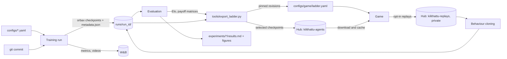

**Checkpoint metadata** (`metadata.json`, stored next to every checkpoint):

```json
{
  "run_id": "2026-11-02-p5-league-main-s1",
  "step": 1850,
  "side": "attack",
  "role_heads": ["crosser"],
  "git_commit": "a1b2c3d",
  "env_version": "1.2.0",
  "rules_hash": "sha256:9f3c…",
  "config": { "...": "fully resolved config" },
  "network": { "d_model": 128, "layers": 3, "heads": 4, "gru": 256 },
  "elo": 1432,
  "parent": "2026-10-20-p4-plus-s1/step-900"
}
```

**Versioning rules**

| Artifact | Rule |
|---|---|
| `ENV_VERSION` | **Major**: rule behaviour changes (old replays and checkpoints are incompatible). **Minor**: new rule toggle, off by default. **Patch**: refactors or speed-ups that leave golden replays unchanged. |
| Checkpoints | Loading with a different major `ENV_VERSION` fails loudly; a different `rules_hash` warns that the policy was trained on other rules. |
| Replays | Header stores `ENV_VERSION`, rules, seed and controller refs; `verify_replay` must pass before a replay enters a dataset. |
| Golden replays | A small set committed in `kilithattu-core/tests/`; any change to their event logs fails CI. |
| Run ids | `<YYYY-MM-DD>-<phase>-<name>-s<seed>`, e.g. `2026-10-20-p4-plus-s1`. |
| Ladder | `configs/game/ladder.yaml` maps each difficulty to a hub repo + commit hash + human-fair settings. |

### 8.7 Runtime and deployment view

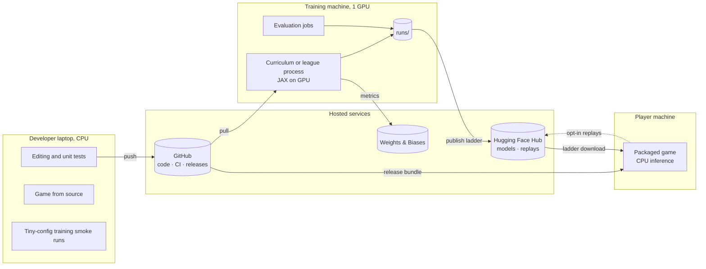

| Process | Runs on | Execution model | Robustness |
|---|---|---|---|
| Training (curriculum / league / FCP) | Training machine | One Python process; JAX owns the GPU; the league manager is a Python loop calling jitted training chunks | Checkpoint + league state (pool, payoff, ratings as JSON) every N updates; resumes from the latest |
| Evaluation | Training machine between chunks, or a second GPU | Vmapped innings and matches | Results appended to run folder; idempotent |
| Game | Laptop or player machine | Single main thread: input → 20 Hz simulation with batched CPU inference → 60 fps render | JIT warm-up at the loading screen; ladder cached locally, works offline after first download |

GitHub-hosted CI runners have no GPU, so GPU jobs run on the training machine (optionally registered as a
self-hosted runner for the nightly benchmark).

### 8.8 Configuration system

- **Typed dataclasses** in code define the schema; **YAML files** are presets; **OmegaConf** merges them.
- **Precedence** (lowest → highest): code defaults → preset (e.g. `configs/rules/plus.yaml`) → experiment or
  training config → command-line overrides.
- The **fully resolved config** is saved with every run, checkpoint and replay.

```bash
uv run kilithattu-train stage --config configs/train/curriculum.yaml \
    rules=configs/rules/plus.yaml train.num_envs=1024 seed=3
uv run kilithattu-eval tournament --config configs/eval/tournament.yaml
uv run kilithattu play --mode play_crosser --difficulty medium
```

### 8.9 Tech stack

| Layer | Choice | Why |
|---|---|---|
| Language / packaging | Python 3.11+, `uv` workspace | Fast, reproducible installs; one lockfile; per-package dependencies |
| Simulation | JAX (`jit`, `vmap`, `lax.scan`) | Thousands of parallel envs on one GPU; the same code runs in the game |
| Networks / optimisation | Flax, Optax, Distrax | Standard JAX stack |
| Structure | `flax.struct` dataclasses, Chex asserts | Pytrees with shape checks |
| MARL reference | PureJaxRL / JaxMARL patterns | Proven fully-jitted PPO / MAPPO designs |
| Configuration | dataclasses + OmegaConf + YAML | Typed, layered, serialisable configs |
| Checkpoints | Orbax + `metadata.json` | Standard JAX checkpointing with provenance |
| Artifact hosting | Hugging Face Hub (`huggingface_hub`) | Versioned model and dataset repos with free hosting |
| Tracking | Weights & Biases (or TensorBoard) | Curves, videos, payoff matrices |
| Hyperparameter / balance search | Optuna | E2 outer loop |
| Game | `pygame-ce` | Simple 2D, gamepad support, runs policies in-process |
| Tests | `pytest`, `hypothesis` | Unit, property, differential and golden-replay tests |
| Quality | `ruff`, `pyright`, `import-linter`, pre-commit | Style, types, dependency contracts |
| CI / releases | GitHub Actions | PR checks, nightly jobs, release builds |
| Game packaging | PyInstaller (CPU JAX) | One-download builds for Linux, Windows and macOS |

**Fallback:** if JAX is a blocker, PettingZoo + PyTorch works with the same package structure, at roughly
10–100× lower training throughput (shrink the league accordingly).

### 8.10 Development workflow, testing and CI

**Workflow**

- `main` is protected; work happens on `feat/…`, `fix/…` and `exp/…` branches merged by pull request with
  green CI (and a review when more than one person is active).
- Commit messages follow Conventional Commits, scoped by package: `feat(core): swept tag test`.
- A **rule change** updates `RULES.md`, the config, the tests, the golden replays and `ENV_VERSION` in the
  **same pull request**.
- Significant design decisions get a short **ADR** in `docs/adr/` (context, decision, consequences).

**Testing strategy**

| Level | What it checks | Where | When |
|---|---|---|---|
| Unit | Geometry, scoring, masks, config loading | each package's `tests/` | every PR |
| Property | Invariants: guards on lines, Kili on graph, κ monotone within a trip, zero-sum rewards | `kilithattu-core/tests` (hypothesis) | every PR |
| Golden replays | Committed replays reproduce identical event logs | `kilithattu-core/tests` | every PR |
| Differential | JAX env matches the reference implementation over 10 000 random rollouts | `kilithattu-core/tests` | nightly |
| Integration | A few MAPPO updates; a league manager with 3 tiny agents; checkpoint round-trip | `kilithattu-train/tests` | nightly |
| Game smoke | Start each mode headless and run 200 ticks | `kilithattu-game/tests` | every PR |
| Performance | Env steps/s and game tick latency against stored baselines | `tools/bench_env.py` | nightly |

**CI workflows**

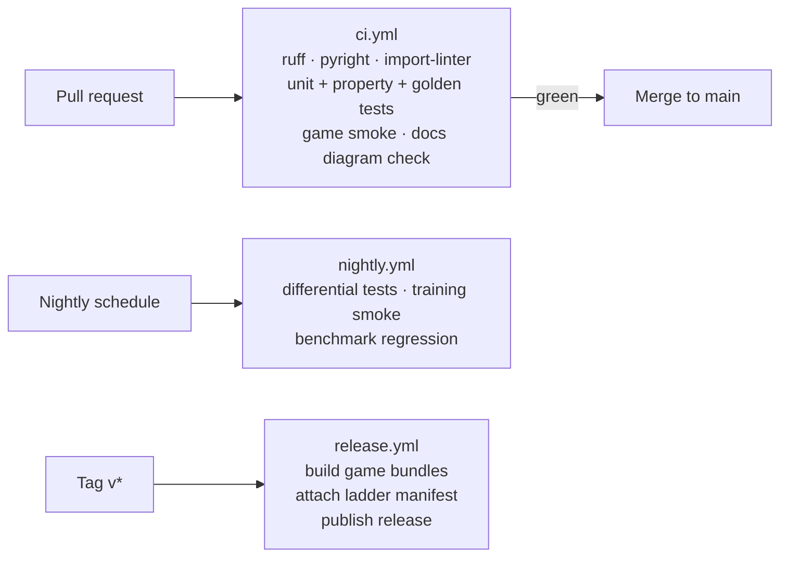

| Workflow | Trigger | Target duration |
|---|---|---|
| `ci.yml` | every pull request and push to `main` | < 10 min |
| `nightly.yml` | nightly and manual | < 60 min |
| `release.yml` | tag `v*` | — |

**Release process**

1. Freeze the ladder: run `tools/export_ladder.py`, upload checkpoints to the hub, commit `ladder.yaml`.
2. Update `CHANGELOG`, bump package versions and `ENV_VERSION` if needed.
3. Tag `vX.Y.Z` → `release.yml` builds the game bundles and publishes the GitHub release.
4. Smoke-test the bundle on a clean machine (the Phase 8 exit criterion).

---

## 9. Step-by-step roadmap

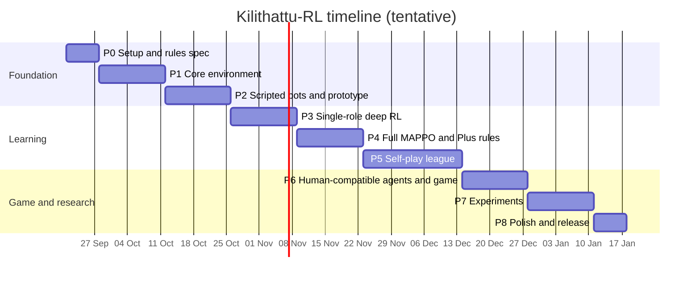

About 17 weeks. Game work in Phases 2 and 6 can run in parallel with training runs.

### Phase 0 — Foundations and rules spec (1 week)

**Objective:** an unambiguous rule set and a working project skeleton.

1. Watch play footage and, if possible, interview people who have played; note differences from §4.
2. Write `RULES.md`: rules R1–R14, toggles P1–P7, parameter table, decision log (it becomes the source of truth).
3. Set up the uv workspace with the five package skeletons (§8.3), shared `ruff` / `pyright` / `pytest`
   config, `import-linter` contracts (§8.4), pre-commit, `ci.yml` (§8.10) and the first ADR (monorepo).
   Create the Hugging Face Hub and W&B projects (§8.2).
4. Install JAX with CUDA, verify the GPU, and run a tiny jitted benchmark.
5. Create configuration dataclasses with YAML presets `classic` and `plus` (§8.8).
6. Write down checkpoint metadata, run-id and versioning conventions (§8.6).

**Deliverables:** `RULES.md`, workspace skeleton, CI.
**Exit criteria:** every rule has a precise numeric definition; CI is green.

### Phase 1 — Core environment (2 weeks)

**Objective:** a correct, fast, deterministic simulation.

1. `geometry.py`: lines, boxes, Kili graph (nodes, edges, adjacency, allowed directions per node).
2. `params.py` / `state.py`: `EnvParams`, `EnvState`, padded to maximum sizes with existence masks.
3. `dynamics.py`: Classic instant velocities; P1 acceleration and stamina; guard projection; Kili graph
   motion with junction snapping.
4. `rules.py`: clap gating, side exits, swept tags (+ P2 cone), crossings and κ scoring, delivery, fouls,
   termination — in the exact order of §5.7.
5. `observe.py`: token builders, fog (P3), delay ring buffer (P7), action masks.
6. `env.py`: `reset(key, params)` and `step(key, state, actions, params)` returning observations, state,
   rewards, dones and an event log.
7. `reference.py`: a plain-Python implementation of the same rules for differential testing.
8. Tests:
   - guards never leave their line; the Kili is always on the graph (property tests);
   - a tag within reach → out; outside the cone (P2) → not out; crossers in safe zones are never tagged;
   - points only when κ increases; a round trip = exactly 18 points; no farming;
   - foul → the correct crosser is out; side exit → out; clap gating and false starts;
   - no tunnelling at maximum relative speed;
   - same seed + actions → identical state hash;
   - JAX env matches the reference env on 10 000 random rollouts.
9. Benchmark steps/s for 1, 64, 1024 and 4096 envs on CPU and GPU → `docs/benchmarks.md`.
10. A minimal debug renderer (static frames / GIFs) to eyeball rollouts.

**Deliverables:** `kilithattu-core` (including `replay.py` and golden replays), test suite, benchmark report.
**Exit criteria:** all tests pass; deterministic; throughput of the random-action env ≥ 10⁶ env ticks/s at
4096 envs on GPU (adjust the target after the first measurement if the hardware differs).

### Phase 2 — Scripted bots, playable prototype, balance v1 (2 weeks)

**Objective:** play the game yourself before any RL, and make sure the rules produce a good game.

1. Scripted crosser, guard and Kili in `kilithattu_agents/scripted/`, implementing the `Policy` protocol (§6.7, §8.5).
2. `kilithattu-game` skeleton: `Controller` protocol and slot manager.
3. pygame renderer: field, lines, players, status icons, tag flashes; fixed-timestep loop with interpolation.
4. `HumanController`: keyboard and gamepad, 8-sector quantisation, tap latching, Kili turn buffering.
5. Modes: Play as crosser, Play as Kili, Watch — all against scripted bots.
6. Replay recorder and a basic viewer.
7. **Balance v1:** run 10 000 scripted-vs-scripted innings sweeping speed ratios, `r_tag` and row depth; pick
   parameters in the competitive band; play-test by hand; freeze **Classic v1** parameters in `RULES.md`.

**Deliverables:** playable game vs scripted bots, replays, `docs/balance.md` v1.
**Exit criteria:** scripted vs scripted averages 1–3 round trips per innings; 20–80 % of innings end
all-out; you and at least two other testers find both roles winnable.

### Phase 3 — Single-role deep RL (2 weeks)

**Objective:** prove the learning pipeline works before adding multi-agent complexity.

1. `kilithattu_agents/networks.py` and `policy.py`: entity-transformer actor and critic (GRU behind a flag).
2. `kilithattu_train/rollout.py` and `mappo.py`: jitted rollout, GAE, PPO update, action masks, value
   normalisation, logging.
3. Train the **attack** policy vs frozen scripted defence through S0–S2.
4. Train the **defence** policy vs frozen scripted attack.
5. Sanity checks: overfit a tiny config; 3 seeds; compare against scripted baselines.
6. Render and review behaviours; save videos to `docs/`.

**Deliverables:** first learned policies, training scripts, dashboards.
**Exit criteria:** learned attack scores ≥ 2× the scripted attack against scripted defence; learned defence
concedes ≤ 0.5× what scripted defence concedes; consistent across 3 seeds.

### Phase 4 — Full multi-agent MAPPO and Kilithattu+ (2 weeks)

**Objective:** both teams learning together on the full game.

1. Both sides learn simultaneously (naive self-play) through S3–S5 → **Classic agents**.
2. Enable GRU memory and P3 fog of war.
3. Centralised critic with full state; IPPO ablation for comparison.
4. Curriculum manager with automatic promotion and stage replay.
5. Load learned policies in the game (`PolicyController`) — first human-vs-RL play.
6. Enable P1 → P2 → P3 → P4 progressively (S6) → **Plus agents**.

**Deliverables:** Classic and Plus agents; RL opponents in the game.
**Exit criteria:** learned teams beat scripted teams in ≥ 90 % of matches under both Classic and Plus; no
degenerate behaviour in 50 reviewed replays.

### Phase 5 — Self-play league (3 weeks)

**Objective:** robust, hard-to-exploit agents and a difficulty ladder.

1. `kilithattu_train/league/` (snapshot pool, PFSP matchmaker, resumable league state) and
   `kilithattu_eval/tournament.py` / `ratings.py` (payoff matrix, Elo, Nash averaging).
2. Main, main-exploiter and league-exploiter learners (vmap the population where memory allows).
3. Enable P5 procedural fields and P6 team calls (S7).
4. Scheduled evaluation: tournaments against all snapshots; exploitability proxy (train a fresh best response
   against a frozen main every N generations).
5. Build the difficulty-ladder manifest from snapshot Elo.
6. Optional: match-aware fine-tuning of the main agents (§5.11) for the top difficulty levels.

**Deliverables:** league main agents, payoff matrices, ladder manifest.
**Exit criteria:** main Elo rises over ≥ 10 snapshot generations; exploitability proxy lower than Phase 4
agents; main beats every snapshot in the pool ≥ 55 % of the time.

### Phase 6 — Human-compatible agents and the full game (2 weeks)

**Objective:** a complete, fun game with AI teammates that work with people.

1. Turn on P7 human-fair reflexes in training.
2. Build the partner pool and train the **teammate attack policy** and **teammate defence policy** (FCP).
3. Possession switching with shadow-mode GRU.
4. Integrate the difficulty ladder; calibrate with play-tests.
5. Complete menus, HUD, tutorial, spectator overlays (win probability, attention lines), audio, Onam theme.
6. Collect opt-in human replays → train the BC human proxy → add it to the partner pool → retrain the
   teammate once.

**Deliverables:** the complete game, teammate policies, human replay dataset v1.
**Exit criteria:** every mode works end to end; p99 tick < 10 ms on a laptop CPU; tester win rate falls
monotonically with difficulty.

### Phase 7 — Experiments (2 weeks)

**Objective:** answer RQ1–RQ6 with evidence.

1. Run E1–E7 (§10.2) with ≥ 3 seeds each.
2. Produce figures and tables with 95 % confidence intervals.
3. Build a catalogue of emergent tactics with replay clips.

**Deliverables:** `docs/report/` results, figures, clips.
**Exit criteria:** each research question has a figure, a statistical result and a short written answer.

### Phase 8 — Polish and release (1 week)

1. README, `RULES.md` final, documentation site or docs folder.
2. Paper-style report and a 3–5 minute demo video.
3. Packaged build with CPU inference; model cards for released checkpoints.
4. Tag `v1.0`.

**Exit criteria:** on a fresh machine, `uv run kilithattu play` reaches gameplay within 5 minutes.

---

## 10. Evaluation and experiments

### 10.1 Metrics

| Metric | Definition | Used in |
|---|---|---|
| Points per innings (PPI) | Mean attack points per innings | all |
| Round trips per innings / all-out rate / innings length | Basic game-outcome statistics | balance, depth |
| Match win rate | Full matches (4 innings) | P3–P5 |
| Elo | Ratings from team matches | league, ladder |
| Nash averaging | Ratings from the payoff matrix's Nash equilibrium | E4 |
| Exploitability proxy | PPI gain of a fresh best response trained for a fixed budget vs the frozen agent, over the agent's own PPI in the same matchup | E4 |
| Non-transitivity | Fraction of 3-cycles in the snapshot tournament graph; Nash support size | E1 |
| Behavioural diversity | Number of clusters of trajectory embeddings (occupancy heatmaps → PCA → k-means, silhouette-selected) | E1 |
| Competitiveness | Entropy of innings-outcome distribution; P(0-point innings); P(≥ 3 round trips) | E1, E2 |
| Generalisation | Held-out-field PPI normalised by in-distribution PPI | E3 |
| Coordination | Foul rate; split-guard events; decoy events | E5, E7 |
| Communication | Mutual information between a call and the next second of behaviour; PPI drop when calls are scrambled | E5 |
| Human–AI teaming | Team PPI with held-out partners; blind human ratings (1–5) | E6 |

**Event detectors** (for E7): *split-guard* = two crossers in the same row engage the same guard within 1 s;
*decoy* = a crosser's approach moves a defender ≥ 2 m and a teammate crosses that line within 1 s;
*Kili bait* = the Kili commits to a segment and a crosser crosses a line the Kili just left.

### 10.2 Experiments

| ID | Question | Setup | Main metrics | Hypothesis |
|---|---|---|---|---|
| E1 | RQ1 rule depth | Reduced-budget leagues for Classic, Classic + each Pk, and Plus; 3 seeds | non-transitivity, diversity, competitiveness | P1 and P2 add the most depth; P3 adds diversity but slows learning |
| E2 | RQ2 RL balancing | Optuna search (30–50 trials) over `v_guard/v_crosser`, `v_kili/v_crosser`, `r_tag`, row depth; each trial = fine-tune from Classic weights + evaluation | competitiveness band + depth | RL-balanced parameters beat hand-balanced v1 on depth and agree with play-testers |
| E3 | RQ3 generalisation | Train on {2×5, 2×7, 3×5}; test on {2×6, 3×7, 2×9, 3×9}; crossers {3, 5, 6} | normalised held-out PPI | ≥ 80 % retention on interpolated sizes, lower on extrapolated |
| E4 | RQ4 league vs naive self-play | Same compute budget for both | exploitability proxy, Nash averaging | League is markedly less exploitable |
| E5 | RQ5 team calls | P6 on vs off vs scrambled | PPI, foul rate, mutual information | Calls reduce fouls and improve coordinated crossings |
| E6 | RQ6 human teaming | FCP teammate vs self-play teammate, with held-out partners and humans (blind A/B, small N) | team PPI, ratings | FCP scores higher with unseen partners and humans |
| E7 | Emergent tactics | Detectors + qualitative replay review across league generations | event frequencies over training | Split-guard and decoy tactics emerge and increase with league training |

The human study is small (≈ 8–12 testers) and will be reported as exploratory.

---

## 11. Risks and mitigations

| Risk | Likelihood | Impact | Mitigation |
|---|---|---|---|
| Our rules differ from how the game is really played | Medium | Medium | Decision log, configurable toggles, validation in Phase 0 |
| Degenerate balance (one side always wins) | High | High | Phase 2 balance, E2, curriculum, shaping |
| Not enough compute | Medium | High | Vmapped JAX, small curricula, smaller league; rent GPU time for Phase 5 only |
| JAX learning curve / debugging jitted code | Medium | Medium | Reference env, `JAX_DISABLE_JIT` debugging, Chex asserts, start from PureJaxRL / JaxMARL examples |
| Training instability / strategy cycling | High | Medium | League, PFSP, snapshots, conservative learning rates |
| Game inference too slow on laptops | Low | Medium | Batched inference, JIT warm-up, smaller distilled model |
| Scope creep | High | Medium | MVP cut line after Phase 4; P5–P7 and stretch goals are optional |
| Too few human testers | Medium | Low | Scripted and BC proxies; clearly labelled small-N study |

---

## 12. Stretch goals

- **Browser version**: a websocket server around the same JAX env, with a canvas client (no rule rewrite).
- **Online multiplayer** with AI filling empty slots.
- **Auto-curriculum** over field configurations (Prioritized Level Replay style).
- **Population-based training** for hyperparameters.
- **Planning agents** (MuZero-style) compared against model-free MAPPO.
- **Offline RL** from human replays.
- **Agent leaderboard** where others submit policies.
- **Malayalam localisation** and commentary overlays.
- **Grounded team calls** with fixed meanings for human–AI communication.

---

## 13. Open questions

1. Which GPU is available, and for how long? This decides league size and experiment budgets.
2. Is there a hard deadline (e.g. a course or thesis)? Adjust phases around the MVP cut line.
3. Comfort with JAX vs PyTorch?
4. Can we reach people who have played Kilithattu to validate the rules?
5. Primary audience: research write-up, portfolio piece or public game? This changes how much time goes to
   polish vs experiments.

---

## 14. Glossary

| Term | Meaning |
|---|---|
| **Kili** | The special, most skilled defender; claps to start and moves along any line |
| **Guard** | A defender confined to one transverse line |
| **Crosser** | An attacking player trying to cross the field and return |
| **Pacha** | "Green" — a crosser on the outbound journey |
| **Uppu** | "Salt" — a crosser who has come out the far side and is returning |
| **Salt delivery** | An uppu returning home; completes a round trip (+6 bonus) |
| **Trip progress (κ)** | Counter of lines crossed in the correct order this trip; prevents point farming |
| **Innings** | One period with fixed attack and defence roles |
| **POSG / Dec-POMDP** | Partially observable stochastic game / decentralised partially observable MDP |
| **CTDE** | Centralised training, decentralised execution |
| **MAPPO / IPPO** | Multi-agent PPO with a centralised critic / independent PPO |
| **GAE** | Generalised advantage estimation |
| **PFSP** | Prioritised fictitious self-play — pick opponents you struggle against more often |
| **FCP** | Fictitious Co-Play — train with a diverse partner pool to cooperate with unseen partners |
| **BC** | Behaviour cloning — supervised learning from recorded human actions |
| **TMECor** | Team-maxmin equilibrium with correlation — the solution concept for team-vs-team zero-sum games |
| **Exploitability** | How much a best-responding opponent can gain against a fixed policy |
| **Nash averaging** | An evaluation method based on the Nash equilibrium of a payoff matrix |

---

## 15. References

**The game**

- Kerala Tourism — *Kilithattu Kali | Uppukali | Onam Games*. https://www.keralatourism.org/onam/onam-games/kilithattukali
- Wikipedia — *Atya patya*. https://en.wikipedia.org/wiki/Atya_patya
- *Kilithattu Kali* Malayalam explainer (YouTube). https://www.youtube.com/watch?v=M3lOgn3hMiY
- KeralaFolklore.com — *Kerala Folk Games*. https://keralafolklore.com/kerala-folk-games.html

**Reinforcement learning**

- Schulman et al. (2017). *Proximal Policy Optimization Algorithms*. arXiv:1707.06347.
- Schulman et al. (2016). *High-Dimensional Continuous Control Using Generalized Advantage Estimation*. ICLR.
- Yu et al. (2022). *The Surprising Effectiveness of PPO in Cooperative Multi-Agent Games*. NeurIPS Datasets and Benchmarks.
- de Witt et al. (2020). *Is Independent Learning All You Need in the StarCraft Multi-Agent Challenge?*
- Vinyals et al. (2019). *Grandmaster level in StarCraft II using multi-agent reinforcement learning*. Nature.
- Baker et al. (2020). *Emergent Tool Use From Multi-Agent Autocurricula*. ICLR.
- Strouse et al. (2021). *Collaborating with Humans without Human Data*. NeurIPS.
- Yu et al. (2023). *Learning Zero-Shot Cooperation with Humans, Assuming Humans Are Biased*. ICLR.
- Balduzzi et al. (2018). *Re-evaluating Evaluation*. NeurIPS.
- Czarnecki et al. (2020). *Real World Games Look Like Spinning Tops*. NeurIPS.
- Farina et al. (2018). *Ex ante coordination and collusion in zero-sum multi-player extensive-form games*. NeurIPS.
- Ng, Harada & Russell (1999). *Policy invariance under reward transformations*. ICML.
- Devlin & Kudenko (2011). *Theoretical considerations of potential-based reward shaping for multi-agent systems*. AAMAS.
- Pardo et al. (2018). *Time Limits in Reinforcement Learning*. ICML.
- Jiang et al. (2021). *Prioritized Level Replay*. ICML.
- Lu et al. (2022). *Discovered Policy Optimisation* (PureJaxRL). NeurIPS.
- Rutherford et al. *JaxMARL: Multi-Agent RL Environments and Algorithms in JAX*.
