# Kilithattu-RL: Learning Team Strategy in a Line-Constrained Traditional Tag Game with Deep Multi-Agent Reinforcement Learning

**Research Proposal** · Draft v1 · 2026-09-16

> Companion documents: [`PLAN.md`](PLAN.md) contains the full game specification, the formal Markov-game
> model, the training design, the interactive game design and the phase-by-phase roadmap. This document
> covers the *why*: background, problem, prior work, gaps and research direction.

---

## Contents

1. [Title and team details](#1-title-and-team-details)
2. [Problem background](#2-problem-background)
3. [Problem statement](#3-problem-statement)
4. [Why reinforcement learning](#4-why-reinforcement-learning)
5. [Literature review: top 6 papers](#5-literature-review-top-6-papers)
6. [Existing systems and product study](#6-existing-systems-and-product-study)
7. [Gap analysis](#7-gap-analysis)
8. [Proposed research direction](#8-proposed-research-direction)
9. [References](#9-references)

---

## 1. Title and team details

**Project title**
Kilithattu-RL: Learning Team Strategy in a Line-Constrained Traditional Tag Game with Deep Multi-Agent
Reinforcement Learning

**Short title**
Kilithattu-RL

**Domain**
Deep reinforcement learning · Multi-agent systems · Game AI · Human–AI interaction · Digital cultural heritage

**Team**

| Role | Name | Registration / ID | Responsibilities |
|---|---|---|---|
| Team lead | *[Name]* | *[ID]* | Coordination, environment design, integration |
| Member | *[Name]* | *[ID]* | Multi-agent RL training, self-play league |
| Member | *[Name]* | *[ID]* | Interactive game, human studies |
| Member | *[Name]* | *[ID]* | Evaluation, experiments, report |

| | |
|---|---|
| **Guide / supervisor** | *[Name, designation]* |
| **Department / institution** | *[Department, institution]* |
| **Programme / course** | *[Programme, semester]* |
| **Repository** | `Kilithattukali` (GitHub: Iruos8805) |
| **Duration** | ≈ 17 weeks (see `PLAN.md` §9) |

---

## 2. Problem background

### 2.1 The game

**Kilithattu Kali**, also called **Uppukali** in parts of the Malabar region, is a traditional team game
played in Kerala, especially during Onam. According to Kerala Tourism:

- The field is a large rectangle, divided into two equal parts lengthwise and into five boxes across.
- Two teams of five play. The most skilled player is chosen as the **Kili** and "has lots of advantages".
  The Kili claps to start the game.
- The opposing team must enter each box and come out without being hit by the Kili or by the players
  standing on the lines. **Only the Kili can move along any line**; the other defenders are restricted.
- Players who come out unhit are called **uppu** (salt); those still in the inner boxes are **pacha**
  (green). **If salt and green are in the same box, it is a foul.**
- The field can be enlarged for more players.
- The game is described as having originated as military training for common people, with a close
  resemblance to the martial art **Kalaripayattu**, and as **slowly losing its popularity**.

Closely related line-tag games exist across South Asia, most notably **Atya-patya** (Maharashtra and Tamil
Nadu), where defenders are confined to trenches, one special defender can also run the central trench, and
attackers score for each trench crossed and for the return journey.

### 2.2 Why the game is disappearing and why that matters

- The rules are passed on **orally** and vary from place to place. Public written sources are brief and
  sometimes ambiguous (for example, how points are counted or what happens after a foul).
- The game needs **ten players, open ground and people who already know the rules**, which is harder to
  arrange in urban settings.
- There is **no digital version**, so younger people have no low-effort way to discover or practise it. Our
  searches found mobile games for the better-known chase game Kho Kho, but none for Kilithattu or
  Atya-patya.

### 2.3 Why the game is interesting for AI

Kilithattu has an unusual structure that is not well covered by existing AI benchmarks:

| Property | What it means in Kilithattu |
|---|---|
| **Team vs team, zero-sum** | Attackers score points; defenders prevent them. |
| **Asymmetric roles** | Free-moving crossers vs line-bound guards vs a roaming Kili. |
| **Movement constraints of different shapes** | Crossers move in 2D; guards move along a 1D line; the Kili moves on a graph of lines. |
| **Coordination under a team constraint** | The uppu/pacha foul rule means returning and outbound teammates must avoid each other's boxes. |
| **Deception and timing** | Feints, decoys, splitting a guard's attention, and the timing of the Kili's clap. |
| **Real-time, simultaneous moves** | All players act at once; reaction time and prediction matter. |
| **Scalable** | Field size and team size can grow. |

### 2.4 Technical context

Deep reinforcement learning has produced strong agents for complex multi-agent games: StarCraft II
(AlphaStar), Quake III Capture the Flag, and emergent strategies in hide-and-seek. Multi-agent PPO has become a
strong, simple baseline, and JAX-based frameworks such as JaxMARL make GPU-parallel multi-agent training much
faster. Separately, research on human–AI coordination (for example Fictitious Co-Play) has shown that agents
trained only against copies of themselves often make poor partners for humans, and that this can be fixed by
training with diverse partners. RL has also started to be used as a **game-design tool**, for example to
balance competitive game levels. These strands have not been brought together for a traditional,
line-constrained team tag game.

---

## 3. Problem statement

> **Kilithattu Kali is a culturally significant, strategically rich team game that exists only as brief,
> partly ambiguous oral and written descriptions, has no digital form, and has never been studied
> computationally.** Its combination of asymmetric roles, line- and graph-constrained movement, a
> team-internal coordination rule (the uppu/pacha foul) and real-time adversarial play is not represented in
> existing multi-agent reinforcement learning benchmarks or in existing digital traditional-game products.

The project addresses this in four parts:

1. **Formalisation.** Turn the traditional rules into an unambiguous, testable, simulated **two-team zero-sum
   partially observable stochastic game**, keeping the identity of the original game (Classic rules) while
   adding optional, clearly separated improvements (Kilithattu+ rules).
2. **Learning.** Train deep multi-agent RL agents that learn strong, robust team strategies for **every role**
   (crosser, guard, Kili) without any human demonstration data, since none exists.
3. **Human interaction.** Deliver an interactive game in which a person can play **as a crosser trying to
   become uppu**, as the Kili or as a guard, with or against RL agents at several difficulty levels. The AI
   teammates must work well with humans, not only with copies of themselves.
4. **Scientific questions.** Use the learned agents to study which rule improvements add strategic depth,
   whether RL can balance the game's parameters, whether policies generalise to different field and team
   sizes, and whether human-compatible training produces better AI teammates.

**Formally**, given the game $\mathcal{G}$ (defined in `PLAN.md` §5), we seek decentralised team policies
$(\pi_A, \pi_D)$ that approximately solve $\max_{\pi_A} \min_{\pi_D} J(\pi_A, \pi_D)$ with low
exploitability, remain effective when some slots are controlled by humans, and generalise across field
configurations — and we use these policies to evaluate rule variants of $\mathcal{G}$.

---

## 4. Why reinforcement learning

### 4.1 The problem has exactly the shape RL is built for

| Characteristic of the problem | Why it points to RL |
|---|---|
| **Sequential decisions with delayed reward** | A point is earned only after many small movement decisions: positioning, feinting, waiting for a gap, crossing. RL learns long-horizon credit assignment. |
| **No expert data** | The game is fading and unrecorded, so supervised or imitation learning has nothing to learn from. RL learns from interaction in simulation. |
| **Adversarial and non-stationary** | The best strategy depends on the opponent's strategy. Self-play and league training let both sides improve together and expose weaknesses. |
| **Multi-agent coordination** | Splitting guards, decoys and foul avoidance need coordinated teams. Multi-agent RL with centralised training and decentralised execution learns this directly. |
| **Large, continuous, partially observed state** | Positions, velocities, stamina and limited vision make exhaustive search or hand-written rules impractical. Deep networks generalise over this space. |
| **Rules we want to change** | Every rule variant or parameter change would require rewriting hand-made AI. With RL, we retrain the same pipeline and the agents adapt. |

### 4.2 Alternatives considered

| Approach | Strengths | Why it is not enough here |
|---|---|---|
| **Scripted / finite-state-machine AI** | Simple, predictable, cheap | Must be hand-written for every role and rule variant; easily exploited by players; cannot discover strategies. *Used as a baseline and tutorial opponent.* |
| **Supervised / imitation learning** | Fast, human-like | Requires recorded human play, which does not exist. *Used later only with opt-in replays collected from our own game.* |
| **Search and planning (e.g. MCTS)** | Strong in turn-based games | Real-time simultaneous moves, 9+ agents, continuous positions and hidden information make the search tree enormous at 20 decisions per second. |
| **Game-theoretic equilibrium solvers** | Exact solutions for small games | Intractable for a continuous, partially observable, 9-agent real-time game. |
| **Evolutionary methods** | Good for parameter search | Sample-inefficient for training large neural policies; *used instead in the outer loop for rule-parameter balancing.* |

### 4.3 What RL uniquely enables in this project

- **Discovery**: strategies nobody wrote down, such as decoy runs and Kili baiting, can emerge and be analysed.
- **A design instrument**: well-trained agents act as tireless play-testers for comparing rule variants.
- **Adaptive opponents and teammates**: a whole difficulty ladder comes directly from training snapshots.

---

## 5. Literature review: top 6 papers

The six papers below were chosen because each directly shapes one part of the proposed system:
the learning algorithm, the training scheme, team play, emergent strategy, human–AI teaming and game balancing.

### Summary

| # | Paper | Venue | Area | Used for |
|---|---|---|---|---|
| P1 | Yu et al., *The Surprising Effectiveness of PPO in Cooperative Multi-Agent Games* | NeurIPS 2022 (Datasets & Benchmarks) | MARL algorithm | Core learning algorithm (MAPPO) |
| P2 | Vinyals et al., *Grandmaster level in StarCraft II using multi-agent reinforcement learning* | Nature, 2019 | League self-play | Self-play league, exploiters, PFSP |
| P3 | Jaderberg et al., *Human-level performance in 3D multiplayer games with population-based reinforcement learning* | Science, 2019 | Team games | Team vs team training, population-based methods, human evaluation |
| P4 | Baker et al., *Emergent Tool Use From Multi-Agent Autocurricula* | ICLR 2020 | Emergent strategy | Entity-attention policies, asymmetric pursuit–evasion, strategy analysis |
| P5 | Strouse et al., *Collaborating with Humans without Human Data* | NeurIPS 2021 | Human–AI teaming | Fictitious Co-Play for human-compatible teammates |
| P6 | Rupp, Eberhardinger & Eckert, *Simulation-Driven Balancing of Competitive Game Levels with Reinforcement Learning* | IEEE Transactions on Games, 2024 | Game design with RL | RL-driven game balancing |

---

### P1 — The Surprising Effectiveness of PPO in Cooperative Multi-Agent Games

**Yu, Velu, Vinitsky, Gao, Wang, Bayen & Wu — NeurIPS 2022, Datasets and Benchmarks Track**

- **Problem.** Off-policy methods were widely assumed to be necessary for sample-efficient multi-agent RL,
  and PPO was considered too sample-inefficient.
- **Method.** Multi-Agent PPO (MAPPO): PPO with a centralised value function that uses global state during
  training, with decentralised actors at execution. The paper studies which implementation details matter:
  value normalisation, the input to the value function, how much data each update reuses, the PPO clipping
  value, and "death masking" for agents that are no longer active.
- **Results.** With little domain-specific tuning, MAPPO is competitive with or better than strong off-policy
  baselines on the multi-agent particle environments, the StarCraft Multi-Agent Challenge, Google Research
  Football and Hanabi.
- **Relevance.** MAPPO is our core algorithm. Its practical recommendations (value normalisation, death masking
  for tagged players, agent-specific global state) are adopted directly.
- **Limitations for our problem.** Evaluated on *cooperative* tasks; it does not address team-vs-team
  zero-sum training, non-transitive strategy cycles or human partners.

### P2 — Grandmaster level in StarCraft II using multi-agent reinforcement learning (AlphaStar)

**Vinyals et al. — Nature 575, 2019**

- **Problem.** StarCraft II is a real-time strategy game with partial observability, a huge action space, long
  horizons and strongly non-transitive strategies.
- **Method.** Policies initialised by imitation of human replays, then improved with a **league**: main agents,
  **main exploiters** that target the current main agents, and **league exploiters** that look for weaknesses
  in the whole league. Opponents are chosen with **prioritised fictitious self-play (PFSP)**, which favours
  opponents the learner struggles against.
- **Results.** Reached Grandmaster level on the official Battle.net ladder, rated above 99.8 % of ranked human
  players.
- **Relevance.** Plain self-play tends to cycle between strategies and forget old counter-strategies. Our
  self-play league (main agents, exploiters, PFSP) follows AlphaStar's design at a much smaller scale, and
  league snapshots also form the game's difficulty ladder.
- **Limitations for our problem.** Relies on large amounts of human replay data (none exists for Kilithattu)
  and enormous compute. Our league must work from scratch and on modest hardware.

### P3 — Human-level performance in 3D multiplayer games with population-based reinforcement learning

**Jaderberg et al. — Science 364, 2019**

- **Problem.** Learning to play a team-based, first-person multiplayer game (Quake III Arena Capture the
  Flag) from pixels and game outcome alone, on procedurally generated maps.
- **Method.** A population of agents trained concurrently with **population-based training**, which also
  evolves each agent's internal reward signals. Agents used a recurrent, two-timescale architecture.
- **Results.** Trained agents exceeded the win rate of strong human players in tournaments, and were evaluated
  both as opponents and as teammates of humans.
- **Relevance.** The closest precedent for *team vs team* deep RL with human play. It motivates our
  population-based training, procedurally varied fields (P5 rule), evaluation with humans as both teammates
  and opponents, and recurrent memory for partial observability.
- **Limitations for our problem.** Teams are symmetric, all players have the same free movement, and there is
  no team-internal constraint like the foul rule.

### P4 — Emergent Tool Use From Multi-Agent Autocurricula (hide-and-seek)

**Baker, Kanitscheider, Markov, Wu, Powell, McGrew & Myers — ICLR 2020**

- **Problem.** Can simple competitive objectives in a physical environment produce increasingly complex
  strategies without hand-designed curricula?
- **Method.** Hiders and seekers trained with large-scale PPO and self-play. Policies use an **entity-based,
  masked self-attention** architecture, so they handle varying numbers of agents and objects.
- **Results.** Six distinct phases of emergent strategy and counter-strategy, including shelter building,
  ramp use and exploiting physics ("box surfing"). The paper also proposes transfer tasks to measure what
  agents have learned.
- **Relevance.** Kilithattu is also an asymmetric team pursuit–evasion game. We adopt the entity-attention
  policy (handles variable field and team sizes), the idea that competition creates an automatic curriculum,
  and the practice of identifying and cataloguing emergent strategy phases. Their unintended physics exploits
  also warn us to test our rules against loopholes.
- **Limitations for our problem.** Movement is unconstrained within each team, roles inside a team are
  identical, and there is no study of human play.

### P5 — Collaborating with Humans without Human Data (Fictitious Co-Play)

**Strouse, McKee, Botvinick, Hughes & Everett — NeurIPS 2021**

- **Problem.** Agents trained by self-play develop private conventions and cooperate poorly with new partners,
  especially humans, while collecting human data is costly.
- **Method.** **Fictitious Co-Play (FCP)**: first train a diverse population of self-play agents and keep past
  checkpoints of varying skill; then train a single agent to be the best partner for this whole population.
- **Results.** In the collaborative cooking game Overcooked, FCP agents scored higher with previously unseen
  agents and with human partners than self-play, population-play and behaviour-cloning baselines, and humans
  reported a strong preference for FCP partners.
- **Relevance.** When a human plays one crosser with three AI teammates, the teammates must adapt to that human.
  We use FCP (plus scripted and later behaviour-cloned partners) to train human-compatible teammates.
- **Limitations for our problem.** Studied in a purely cooperative two-player setting. Our setting adds
  adversaries, four-player teams, real-time control and player switching mid-game.

### P6 — Simulation-Driven Balancing of Competitive Game Levels with Reinforcement Learning

**Rupp, Eberhardinger & Eckert — IEEE Transactions on Games, 2024**

- **Problem.** Balancing competitive two-player game levels, especially non-symmetric ones, normally takes
  a lot of manual design and testing.
- **Method.** Framed as procedural content generation with RL (PCGRL): a level generator, a **balancing agent**
  that edits levels, and a **simulation** that measures balance to produce the reward. Introduces swap-based
  level representations to keep levels playable.
- **Results.** Validated in Neural MMO in a two-player competitive setting; the swap-based representation
  balanced levels more effectively and faster than the standard PCGRL approach.
- **Relevance.** Shows RL can be a practical game-balancing tool. We extend the idea from level layouts to
  **rule parameters and rule variants** (speeds, tag reach, field size, Kilithattu+ rules), using learned
  team agents as the simulated players.
- **Limitations for our problem.** Balances map layouts for two players with fixed behaviour; it does not
  measure strategic depth or deal with teams, asymmetric roles or co-adapting learned agents.

### 5.1 Synthesis

| Aspect | P1 | P2 | P3 | P4 | P5 | P6 | **This project** |
|---|---|---|---|---|---|---|---|
| Multi-agent teams | ✓ | ✗ | ✓ | ✓ | 2 players | ✗ | ✓ |
| Competitive (zero-sum) | ✗ | ✓ | ✓ | ✓ | ✗ | ✓ | ✓ |
| Asymmetric roles within a team | ✗ | ✗ | ✗ | ✗ | ✗ | ✗ | ✓ |
| Constrained movement (lines / graph) | ✗ | ✗ | ✗ | ✗ | grid | grid | ✓ |
| League / population training | ✗ | ✓ | ✓ | ✗ | ✓ | ✗ | ✓ |
| Variable team / map size | ✗ | ✗ | maps | ✓ | ✗ | maps | ✓ |
| Human–AI teaming | ✗ | ✗ | ✓ | ✗ | ✓ | ✗ | ✓ |
| Game balancing / rule design | ✗ | ✗ | ✗ | ✗ | ✗ | ✓ | ✓ |
| No human data needed | ✓ | ✗ | ✓ | ✓ | ✓ | ✓ | ✓ |

✓ = a central feature of the work · ✗ = not addressed. The table summarises the main setting of each paper,
not every experiment in it.

---

## 6. Existing systems and product study

### 6.1 Digital versions of traditional South Asian tag games

| System | What it is | AI approach | Observations |
|---|---|---|---|
| **Kho Kho World Cup** (Google Play) | Mobile Kho Kho game with short matches and simple controls | Not documented; no indication of learning agents | Shows there is interest in digital traditional sports |
| **Kho Kho Sports Run Chase Game** (Google Play) | 3D Kho Kho chase simulation | Not documented; no indication of learning agents | Arcade-style; no rule variants or difficulty from learning |
| **Kerala Tourism – Onam Games pages** | Text descriptions of Kilithattu and other games | None | Documentation only; brief and partly ambiguous |
| **Atya-patya associations and heritage sites** (e.g. Tamil Nadu Atya-Patya, Bharatiya Khel) | History and rules of Atya-patya | None | Documentation only |
| **Kilithattu / Atya-patya digital games** | — | — | **None found in our searches** |

### 6.2 Research systems for multi-agent game AI

| System | Game type | Key features | Limitations relative to Kilithattu |
|---|---|---|---|
| **Google Research Football** (Kurach et al., AAAI 2020) | 3D football simulation | Full-game and "academy" scenarios; widely used MARL benchmark | Mostly symmetric teams with free movement; no line constraints |
| **Unity ML-Agents DodgeBall** | Team shooter (Elimination, Capture the Flag) | MA-POCA centralised-critic trainer, variable-length observations, self-play | Symmetric teams, free movement; a showcase environment rather than a research study |
| **Multi-agent particle environments / PettingZoo** (Lowe et al., 2017; Terry et al., 2021) | Simple 2D tasks incl. predator–prey | Standard API; lightweight | Small, abstract tasks; homogeneous movement; not a real game |
| **OpenAI hide-and-seek environment** (Baker et al., 2020) | Physics-based hide-and-seek | Asymmetric teams, objects, emergent strategies | Unconstrained movement; no human play |
| **Overcooked-AI** (Carroll et al., NeurIPS 2019) | Cooperative cooking game | Standard human–AI coordination benchmark with human data | Purely cooperative; no opponents |
| **JaxMARL** (Rutherford et al., NeurIPS 2024 Datasets & Benchmarks) | Framework of JAX multi-agent environments and algorithms | GPU-parallel environments; reports training pipelines up to 12,500× faster in wall-clock time than existing approaches | A toolkit, not a game; contains no line-constrained tag game |
| **Chain-catch / kabaddi pursuit–evasion simulator** ("Multiagent Pursuit Evasion, or Playing Kabaddi") | Kabaddi-like chain catch with simulated and physical robots | Encodes game rules; cost-model strategies for escapee, catcher and chain roles | Hand-designed strategies, no reinforcement learning, no human play |

### 6.3 Feature comparison

| Feature | Kho Kho mobile games | Google Research Football | ML-Agents DodgeBall | Hide-and-seek | Overcooked-AI | JaxMARL | Kabaddi simulator | **Kilithattu-RL (proposed)** |
|---|---|---|---|---|---|---|---|---|
| Traditional / cultural game | ✓ | ✗ | ✗ | ✗ | ✗ | ✗ | ✓ | ✓ |
| Formal, open rule specification | ✗ | ✓ | ✓ | ✓ | ✓ | ✓ | ✓ | ✓ |
| Learning agents (deep RL) | ✗ | ✓ | ✓ | ✓ | ✓ | ✓ | ✗ | ✓ |
| Team vs team, competitive | ✓ | ✓ | ✓ | ✓ | ✗ | some envs | ✓ | ✓ |
| Asymmetric roles within a team | — | partial | ✗ | ✗ | ✗ | some envs | ✓ | ✓ |
| Line- or graph-constrained movement | — | ✗ | ✗ | ✗ | grid | ✗ | ✗ | ✓ |
| Team-internal coordination rule | — | ✗ | ✗ | ✗ | ✗ | ✗ | ✗ | ✓ (foul rule) |
| Human plays with / against agents | ✓ (scripted AI) | ✓ | — | ✗ | ✓ | ✗ | ✗ | ✓ |
| Human-compatible teammate training | ✗ | ✗ | ✗ | ✗ | ✓ | ✗ | ✗ | ✓ |
| Rule-variant / balance study | ✗ | ✗ | ✗ | ✗ | ✗ | ✗ | ✗ | ✓ |
| GPU-parallel simulation | ✗ | ✗ | ✗ | ✗ | ✗ | ✓ | ✗ | ✓ |

✓ = present · ✗ = absent · — = unknown or not documented · "partial" / "some envs" = present only in part.
Entries for commercial apps are based on their public store descriptions only.

---

## 7. Gap analysis

| # | Gap | Evidence | Consequence | How this project addresses it |
|---|---|---|---|---|
| **GAP-1** | **No formal or digital model of Kilithattu** | Only short text descriptions exist; no digital games found, while other traditional games (Kho Kho) have mobile versions | The game cannot be studied, taught interactively or preserved in playable form; rule ambiguities stay unresolved | An unambiguous, tested rule specification with a decision log (`RULES.md`), and a JAX simulation of Classic rules |
| **GAP-2** | **No MARL benchmark with heterogeneous movement constraints in one game** | Football, DodgeBall, CTF, hide-and-seek and particle environments give all players the same kind of free movement | Unknown how well standard MARL methods handle teams whose agents live on different movement structures (2D plane, 1D line, graph) | Crossers (2D), guards (1D lines) and the Kili (line graph) in one environment, with a shared entity-attention architecture |
| **GAP-3** | **Team-internal coordination constraints are rarely modelled** | Existing team games reward coordination but do not *forbid* teammate configurations | Little evidence on whether agents learn "traffic management" among teammates under a hard rule | The uppu/pacha foul rule; measurement of foul rates, scheduling behaviour and the effect of team calls |
| **GAP-4** | **Human–AI teaming research is mostly in cooperative games** | FCP and Overcooked-AI are purely cooperative; CTF evaluated human teammates but did not target human-compatible training | Unclear whether human-compatible training methods transfer to competitive team games with real-time control and player switching | FCP-style teammate training with scripted, checkpoint and behaviour-cloned partners; human studies in a competitive game |
| **GAP-5** | **RL-based balancing focuses on level layouts for two players** | Rupp et al. balance map layouts in a two-player setting | Rule design for team games, and measures of strategic depth, are not addressed | RL-driven tuning of rule parameters and evaluation of rule variants using strategic-depth metrics (non-transitivity, strategy diversity, competitiveness) |
| **GAP-6** | **Digital traditional games use fixed scripted AI** | Store descriptions of Kho Kho games show no learning agents or adaptive difficulty | Opponents are easy to exploit; no fair, graded challenge; no strategy insight | A difficulty ladder built from league snapshots, with human-fair reaction delays |
| **GAP-7** | **Generalisation across field and team sizes is rarely tested in team games** | Most benchmarks fix team sizes; the traditional game explicitly scales with more players | Agents may overfit to one configuration | Procedurally varied fields and team sizes, with held-out configurations for testing |
| **GAP-8** | **Strategy in traditional Indian tag games has not been studied with learning agents** | The kabaddi simulator uses hand-designed cost models; no RL studies of Kilithattu or Atya-patya were found | Tactics are known only informally | Catalogue of emergent tactics (decoys, splitting guards, Kili baiting) with replay evidence |

---

## 8. Proposed research direction

### 8.1 Aim

To formalise Kilithattu Kali as a multi-agent reinforcement learning environment, train robust and
human-compatible agents for all of its roles, deliver an interactive game built on those agents, and use them
to study rule design, balancing, generalisation and human–AI teaming in asymmetric, movement-constrained team
games.

### 8.2 Objectives

| # | Objective | Addresses |
|---|---|---|
| O1 | Specify the Classic rules precisely and implement a fast, deterministic, tested JAX environment, plus optional Kilithattu+ rules (momentum and stamina, facing, limited vision, strategic clap, variable fields, team calls, human-fair reflexes) | GAP-1, GAP-2 |
| O2 | Train agents for crossers, guards and the Kili using MAPPO with entity attention, a curriculum and a self-play league | GAP-2, GAP-3, GAP-8 |
| O3 | Train human-compatible teammates with Fictitious Co-Play and evaluate them with unseen partners and humans | GAP-4 |
| O4 | Build an interactive game where any player slot can be a human, an RL agent or a scripted bot, with a learned difficulty ladder | GAP-1, GAP-6 |
| O5 | Use agents to compare rule variants and tune rule parameters for balance and strategic depth | GAP-5 |
| O6 | Measure generalisation across field and team sizes, and catalogue emergent tactics | GAP-7, GAP-8 |

### 8.3 Research questions

| ID | Research question | Experiment |
|---|---|---|
| RQ1 | Which Kilithattu+ rules increase strategic depth without making the game degenerate? | E1: rule-layer ablation |
| RQ2 | Can RL agents automatically balance the game's parameters, and do their choices agree with human play-testers? | E2: RL-driven balancing |
| RQ3 | Does an entity-attention policy generalise to unseen field and team sizes? | E3: held-out configurations |
| RQ4 | How much does league training reduce exploitability compared to naive self-play in this asymmetric team game? | E4: league vs self-play |
| RQ5 | Do meaningful team calls emerge, and do they reduce fouls and improve coordination? | E5: calls on / off / scrambled |
| RQ6 | Does Fictitious Co-Play produce better AI teammates for humans than self-play agents? | E6: human–AI teaming study |

### 8.4 Methodology overview

```mermaid
flowchart LR
    A["1 · Rule study<br/>sources, footage, players"] --> B["2 · Formal model<br/>two-team zero-sum POSG"]
    B --> C["3 · JAX environment<br/>Classic + Kilithattu+"]
    C --> D["4 · Scripted bots<br/>baselines + prototype game"]
    D --> E["5 · MAPPO + curriculum<br/>entity attention, GRU"]
    E --> F["6 · Self-play league<br/>PFSP, exploiters"]
    F --> G["7 · Human-compatible teammates<br/>Fictitious Co-Play"]
    G --> H["8 · Interactive game<br/>difficulty ladder"]
    F --> I["9 · Experiments E1–E7"]
    H --> I
    I --> J["10 · Findings + release"]
```

| Stage | Method | Details |
|---|---|---|
| Formal model | Two-team zero-sum partially observable stochastic game; factorised discrete actions matching human controls | `PLAN.md` §5 |
| Environment | JAX with `jit` / `vmap`; property tests and a differential test against a plain-Python reference implementation | `PLAN.md` §9, Phase 1 |
| Learning | MAPPO (centralised critic, decentralised actors), entity-attention encoder with GRU memory, potential-based reward shaping annealed to zero, 8-stage curriculum | `PLAN.md` §6.1–6.4 |
| Robustness | Self-play league with main agents, main exploiters, league exploiters and PFSP; Elo and Nash averaging | `PLAN.md` §6.5 |
| Human compatibility | Fictitious Co-Play with checkpoint, scripted and behaviour-cloned partners; observation delay and sticky actions | `PLAN.md` §6.6 |
| Game | pygame client sharing the same environment code; slot-based controllers; replays | `PLAN.md` §7 |
| Evaluation | Win rate, Elo, exploitability proxy, non-transitivity, strategy diversity, generalisation, human ratings; ≥ 3 seeds with 95 % confidence intervals | `PLAN.md` §10 |

### 8.5 Expected contributions

1. **The first formal, open, playable model of Kilithattu Kali**, with a documented interpretation of its rules.
2. **A new multi-agent RL environment** combining asymmetric roles, heterogeneous movement constraints (plane, line, graph) and a team-internal coordination rule, GPU-accelerated in JAX.
3. **Trained agents and an empirical study** of learning, league robustness and emergent tactics in this setting.
4. **Evidence on human–AI teaming in a competitive team game**, comparing Fictitious Co-Play with self-play teammates.
5. **A method and results for RL-driven rule design**, measuring how rule variants change balance and strategic depth.
6. **An interactive game** that lets people learn and play a fading traditional game with AI teammates and opponents.

### 8.6 Scope and assumptions

- **In scope:** top-down 2D simulation, Classic and Kilithattu+ rules, single-machine training, a local game,
  and small-scale human studies (≈ 8–12 participants, reported as exploratory).
- **Out of scope:** 3D graphics, realistic body physics, online multiplayer, and declaring one official
  historical rule set.
- **Assumptions:** access to at least one modern GPU for the league phase; the Classic rules as interpreted in
  `PLAN.md` §4 can be revised after checking footage and talking to people who have played.

### 8.7 Expected outcomes and success criteria

| Outcome | Success criterion |
|---|---|
| Environment | All rule and differential tests pass; deterministic replays |
| Agents | League agents beat scripted teams in ≥ 95 % of matches; exploitability lower than naive self-play |
| Game | All modes playable; human win rate decreases with difficulty |
| Research | RQ1–RQ6 each answered with ≥ 3 seeds and confidence intervals |
| Dissemination | Open repository, report and demo video |

### 8.8 Timeline

| Weeks | Phase |
|---|---|
| 1 | Rule study and project setup |
| 2–3 | Core JAX environment |
| 4–5 | Scripted bots, prototype game, first balance |
| 6–7 | Single-role deep RL |
| 8–9 | Full MAPPO with Kilithattu+ rules |
| 10–12 | Self-play league |
| 13–14 | Human-compatible agents and full game |
| 15–16 | Experiments |
| 17 | Report, demo and release |

---

## 9. References

**Traditional game sources**

1. Kerala Tourism. *Kilithattu Kali | Uppukali | Onam Games.* https://www.keralatourism.org/onam/onam-games/kilithattukali
2. Wikipedia. *Atya patya.* https://en.wikipedia.org/wiki/Atya_patya
3. Bharatiya Khel. *Atya-patya.* https://bharatiyakhel.in/atya-patya/
4. Tamil Nadu Atya-Patya. *History of Atya Patya.* https://tnatyapatya.com/about-us/
5. KeralaFolklore.com. *Kerala Folk Games.* https://keralafolklore.com/kerala-folk-games.html

**Core literature (Section 5)**

6. Yu, C., Velu, A., Vinitsky, E., Gao, J., Wang, Y., Bayen, A., & Wu, Y. (2022). The Surprising Effectiveness of PPO in Cooperative Multi-Agent Games. *NeurIPS Datasets and Benchmarks Track.* arXiv:2103.01955
7. Vinyals, O., et al. (2019). Grandmaster level in StarCraft II using multi-agent reinforcement learning. *Nature*, 575, 350–354.
8. Jaderberg, M., et al. (2019). Human-level performance in 3D multiplayer games with population-based reinforcement learning. *Science*, 364(6443), 859–865.
9. Baker, B., Kanitscheider, I., Markov, T., Wu, Y., Powell, G., McGrew, B., & Myers, I. (2020). Emergent Tool Use From Multi-Agent Autocurricula. *ICLR.* arXiv:1909.07528
10. Strouse, D. J., McKee, K., Botvinick, M., Hughes, E., & Everett, R. (2021). Collaborating with Humans without Human Data. *NeurIPS.*
11. Rupp, F., Eberhardinger, M., & Eckert, K. (2024). Simulation-Driven Balancing of Competitive Game Levels with Reinforcement Learning. *IEEE Transactions on Games.* https://ieeexplore.ieee.org/document/10528885/ · arXiv:2503.18748

**Existing systems (Section 6)**

12. Kurach, K., et al. (2020). Google Research Football: A Novel Reinforcement Learning Environment. *AAAI.*
13. Unity Technologies. *ML-Agents DodgeBall environment.* https://github.com/Unity-Technologies/ml-agents-dodgeball-env · *ML-Agents plays DodgeBall* (Unity Blog). https://blog.unity.com/engine-platform/ml-agents-plays-dodgeball
14. Lowe, R., Wu, Y., Tamar, A., Harb, J., Abbeel, P., & Mordukhovich, I. (2017). Multi-Agent Actor-Critic for Mixed Cooperative-Competitive Environments. *NeurIPS.*
15. Terry, J. K., et al. (2021). PettingZoo: Gym for Multi-Agent Reinforcement Learning. *NeurIPS.*
16. Carroll, M., Shah, M., Ho, M. K., Griffiths, T. L., Seshia, S. A., Abbeel, P., & Dafoe, A. (2019). On the Utility of Learning about Humans for Human-AI Coordination. *NeurIPS.*
17. Rutherford, A., et al. (2024). JaxMARL: Multi-Agent RL Environments and Algorithms in JAX. *NeurIPS Datasets and Benchmarks Track.* arXiv:2311.10090
18. *Multiagent Pursuit Evasion, or Playing Kabaddi.* https://www.researchgate.net/publication/220946764_Multiagent_Pursuit_Evasion_or_Playing_Kabaddi
19. *Kho Kho World Cup* (Google Play). https://play.google.com/store/apps/details?id=com.sparkshift.khokho
20. *Kho Kho Sports Run Chase Game* (Google Play). https://play.google.com/store/apps/details?id=com.steelwingstudio.khokho

**Further reading used in the plan**

21. Schulman, J., et al. (2017). Proximal Policy Optimization Algorithms. arXiv:1707.06347
22. Balduzzi, D., et al. (2018). Re-evaluating Evaluation. *NeurIPS.*
23. Czarnecki, W. M., et al. (2020). Real World Games Look Like Spinning Tops. *NeurIPS.*
24. Ng, A. Y., Harada, D., & Russell, S. (1999). Policy invariance under reward transformations. *ICML.*
25. Devlin, S., & Kudenko, D. (2011). Theoretical considerations of potential-based reward shaping for multi-agent systems. *AAMAS.*
